# NNC Classifier Study Report

## 0. Findings and recommendations (written 2026-10-07, after the forward_mae campaign)

Read this section first. Everything below it is the phase-by-phase record.

### 0.1 Three headline conclusions

**(a) Raw OHLCV beats the technical indicators, consistently.** At matched architecture on
evaluation window A, `raw8` (8 raw price/volume features) beats `ind24` (the 24-indicator
production set) on **8 of 8** architectures, by **0.018 to 0.030 MCC**. Adding the
indicators to raw OHLCV (`both32`) is also worse than raw alone on 7 of 8.

| arch | raw8 | ind24 | both32 |
|---|---|---|---|
| LSTM_RAW | **0.2857** | 0.2669 | 0.2806 |
| LSTM_NOCONV | **0.2848** | 0.2615 | 0.2816 |
| LSTM_PONDER | **0.2848** | 0.2548 | 0.2777 |
| LSTM_W64 | **0.2842** | 0.2615 | 0.2746 |
| LSTM_KAN | **0.2841** | 0.2615 | 0.2802 |
| LSTM_D10 | **0.2840** | 0.2592 | 0.2763 |
| LSTM_NORESIZE | 0.2832 | 0.2589 | **0.2846** |
| GRU_FAM | **0.2829** | 0.2651 | 0.2737 |

For scale: that indicator penalty is **5-20x the entire spread among the four stage-D
finalists** (0.0015). It is the largest effect the study found, and it is
architecture-independent. This answers spec phase 7(a): raw normalised OHLCV suffices, and
the indicator battery is not merely redundant on this label but actively harmful.

**(b) Recommended `seq_len` is 32 — on cost, not on score.** The ladder rises monotonically
with lookback, so 64 is marginally the best scorer; 32 is the efficient choice and 16 (what
production runs) is measurably worse.

| arch | sl16 | sl32 | sl64 | sl128 |
|---|---|---|---|---|
| LSTM_FAM h32/d2 (pooled, 3 windows) | 0.2277 | 0.2321 | 0.2343 | no gain (window A: flat) |
| LSTM_RAW (pooled, 3 windows) | not run | 0.2343 | 0.2353 | — |

So: **16 -> 32 is a real gain (+0.0044)**, 32 -> 64 is +0.0010 which is inside seed noise
(per-window seed sd 0.0006-0.0046) and costs 457 s/run against 200 s. 64 -> 128 buys
nothing on either label. Caveat: `LSTM_RAW` itself was never run at 16; the 16-vs-32 gap is
measured on `LSTM_FAM`, the only architecture with a complete ladder.

**(c) Every number here is on `forward_mae`, not the production `gbb` label.** The campaign
used forward_mae H12, min_gain/min_loss 1.5%, max_drawdown 10%, chosen because it beat
strict triple barrier at 11 of 11 matched cells. Production `NNNC_MLX` trains `gbb`.
**Nothing in (a) or (b) is established for gbb**, and the gbb label is known to be
half a threshold rule (see the trigger-rule findings below), so it may behave differently.
Replicating (a) on gbb is the single highest-value follow-up.

### 0.2 Mainline recommendation

**No architecture should be promoted to mainline on this study alone.** The study measures
learnability against generated labels; it contains no P&L by design (FR-036). This repo has
seven model-side interventions across two strategy families in which every win came from a
gate or mechanism change and every model-side change was null. A classification-metric win
is a necessary screen, not evidence of edge.

What the evidence does support, in priority order:

1. **Replicate the input-set result on `gbb`** (8 archs x 3 input sets, window A, 2 seeds —
   about a day). Input set is a bigger lever than architecture by an order of magnitude and
   production is currently on the losing side of it. This requires no architecture change.
2. **If an architecture moves, `LSTM_RAW` is the candidate** — 0.2860 against production
   `LSTM`'s 0.2820 in the census, at 6,907 parameters. Production's conv front-end and
   resize do not earn their keep on this label: `LSTM_NOCONV` (0.2848) and `LSTM_RAW` both
   beat the full stack. `NNNC_A_Raw.py` already exists, so this is a walk-forward harness
   run, not new code. **Judge it on pooled walk-forward P&L, never on MCC.**
3. **Stop searching architectures.** Attention, convolutional, state-space, mixer and
   patching families all lose by 0.02-0.05. Capacity is inert across a 14x parameter range,
   confirmed four independent times. The line is closed; closing it was the campaign's real
   product.

### 0.3 Operational hazard

`LSTM_FAM` at `hidden=64` diverges to NaN at `seq_len=64` while training cleanly at
`seq_len=16` (ok 24/24 vs failed 4/4). Production runs seq_len 16 so it is not currently
exposed, but raising the window at that width will produce a silent NaN. Worth a guard in
`create_model`.

### 0.4 The caveat that governs everything above

`PERSISTENCE` — predict the previous bar's label — scores **0.7667** against the best
model's **0.2358**. The overwhelming majority of what is predictable in these labels is
their own autocorrelation, much of it an artefact of zero-volume gap-fill bars (22-55% of
15m bars for six of the eleven production pairs). Until feature 020 addresses that, every
comparison in this report is a contest over a small residue, and fixing the data is worth
more than anything in section 0.2.


This report measures **classifiers**, not strategies. Every number in it is a classification metric computed against the fixed, pre-existing ternary gbb labels (SELL=0, HOLD=1, BUY=2). Learnability is not evidence of trading edge (Constitution III): these are screening results that select candidate architectures and inputs for a later, separate, P&L-based evaluation; nothing here promotes anything to production.

Generated: 2026-09-19T15:33:45.161282+00:00, git sha `32c2504`

## 1. Scope & methods

# Methods notes

## Label fidelity (T026)

`PYTHONPATH=. .venv/bin/python scripts/check_label_fidelity.py --pair LINK/USDT` → `IDENTICAL (n=163666)`, exit 0 (2026-09-16). The harness label shim reproduces the StrategyResolver-loaded NNNC_MLX `get_training_labels` output byte-for-byte on the full LINK/USDT history.

## ROCKET baseline: seed-instability defect and fix (2026-09-16)

Observed on the pooled data: 4 of 9 phase-2 ROCKET runs (windows B seeds 1-2, C seeds 1-2) never
improved on their epoch-0 validation MCC and early-stopped into all-HOLD or all-BUY (best_epoch 0).
RIDGE on the identical training loop was stable on every window and seed, so the loop was not at fault.

Diagnosis (LINK/USDT, 100k training windows, untrained model, CPU): PPV features are well behaved
(mean 0.50, per-feature std 0.14, bounded [0,1]); MAX-pooled features are heavy-tailed (per-feature
std ~1.0, batch maxima 41 / 60 / 52 for seeds 0/1/2). Through the random head this gives a wildly
seed-dependent initial prediction: seed 0 predicted SELL for 77% of rows, seed 1 BUY for 99.96%,
seed 2 SELL for 95%. From such a start the shared loop (lr 1e-4, focal loss, patience 10) could not
recover before early stopping fired. Also noted: at seq_len 16 with kernel length 9 every kernel has
dilation 1, so the "multi-scale" property of MiniRocket is absent at the production window length.

Fix (NNNClassifierMLX_Rocket, hp `feature_norm`, new default `standardize`): per-feature mean/std
of the frozen PPV+MAX features are calibrated on the first training batches, then frozen alongside
the kernels; `feature_norm: none` reproduces the old behaviour. On LINK/USDT (60k train / 10k val,
8 epochs, CPU) all three seeds now improve monotonically past epoch 0 (best_epoch 6-7). The phase-2
entry was changed to `hp: {feature_norm: standardize}` (config id 12c3636e7110); the pre-fix rows
remain in results.jsonl under the old id as history and are excluded from the leaderboard narrative.

## Multihead phase-3 rows quarantined and re-run (2026-09-17)

During the period when two phase-3 trainer processes ran concurrently (22:20-22:40 UTC 2026-09-16),
four Multihead keys (A/1, B/0, B/1, C/0) were trained twice at once. Both processes wrote to the
same checkpoint file, so each pair reports identical metrics despite different epochs_run /
best_epoch, i.e. both restored the other's checkpoint. All 9 Multihead phase-3 lines were removed
from results.jsonl (backup: report/logs/results_before_multihead_rerun.jsonl) and the 6 keys were
re-run in isolated subprocesses with a single trainer. No other phase-3 run overlapped another.
Re-run result (isolated, single trainer): Multihead pooled MCC 0.515 ± 0.018 (A 0.560, B 0.478, C 0.506),
6/6 ok. The contaminated pairs had reported 0.516/0.467/0.496/0.525 with identical metrics across
duplicates; the clean A/1 is 0.54, so the earlier A gap was the shared-checkpoint artefact.

## Early-stopping variance dominates B/C results under the study protocol (2026-09-17)

Third-seed runs (seed 2 on the failing window) for the 12 stability-only failures of gate 3
showed that runs which trained to the 40-epoch cap (best_epoch 30-39) reach MCC 0.64 on windows
B and C with near-identical prediction counts across architectures (LSTM, LSTM_D10, NOISY,
NORES, Mamba2, Wavenet: ~19.2k SELL / 140.5k HOLD / 31.3k BUY on C), i.e. the same ceiling
every type reaches on window A (0.66). Seed-0/1 runs that early-stopped at epochs 12-17 with
best_epoch 1-6 sit at 0.45-0.55. The only seed-2 run that also stalled (LSTM_NORESIZE C,
best_epoch 6) scored 0.504. Three-seed stds are 0.07-0.12.

Interpretation: with lr 1e-4, cap 40 and patience 10, whether a run converges is a coin flip
decided during an early validation plateau, and the cap is binding for the runs that do
converge. Between-seed and between-architecture differences on B/C in phases 3-4 are therefore
mostly training-protocol variance. Any architecture that converges reaches the same ceiling.

Phase 4 (stride 2) was paused after 51 runs: 23 of 49 scored runs stalled (best_epoch <= 6),
all on B/C, none on A. A protocol calibration (production LSTM, window C, 3 seeds each) of
lr 3e-4 vs patience 20 decides the protocol for phases 4-7; phase-3 rows stand as the
"production protocol" reference. `train` settings are part of the config id, so re-runs under
the new protocol get new ids and the old rows remain as history.

## Pure recurrent family types: per-bar input LayerNorm blocked learning on B/C (2026-09-17)

Under the amended protocol (lr 3e-4, stride 2) LSTM_FAM/GRU_FAM reached the window-A ceiling
(0.64-0.65) but stayed flat at 0.44-0.53 validation MCC on B/C for 40 epochs, for every size,
depth and direction. Discriminating runs on window C, seed 0: LSTM_RAW 0.638, LSTM_NOCONV
0.640, production GRU 0.637 (no input LayerNorm), LSTM_FAM hidden 64 with `input_norm: false`
0.633 and with both norms off 0.630, versus 0.504 with the per-bar feature LayerNorm. The
LayerNorm across the 24 features of each bar erases absolute feature levels (the label-trigger
inputs guard_metric and bb_width among them). Fix: `input_norm` default is now False (commit
after c2c54ca); phase-4 RNN entries carry `input_norm: false` explicitly, so their config ids
differ from the 30 earlier rows, which remain as history. LSTM_FAM hidden 256 still diverged on
window A under the earlier default; it is re-run under the new default and reported as
"diverged under the shared protocol" if it fails again.

## Warm-start defect in re-runs (found 2026-09-17 23:40, fixed in run.py)

`MLXClassifierNary.train()` loads an existing model file at `model_path` before training and
continues from those weights even with `force_train=True`. The harness stores the model and the
best-epoch checkpoint at the same per-(config_id, seed) path, so any re-run of an existing key
warm-started from stale weights: (a) the Multihead re-run (6 keys) started from the
contaminated concurrent-run checkpoints; (b) five phase-3 runs killed mid-training by trainer
restarts were resumed from their partial checkpoints (LSTM2 A/0, CNN A/1, Multihead A/0 and
B/1, Mamba2 B/1); (c) the RNN-ablation `default` arm failed to load a checkpoint from the
input-norm era of the same config id. Fix: run.py now deletes any file at the key's model and
checkpoint paths before training (`stale_files_removed` recorded on the row) and fails a row
whose training ran zero epochs. The keys in (a) and (b) are re-run cleanly (rows replaced;
backup `report/logs/results_before_clean_rerun.jsonl`); everything else trained from scratch
because its key had no prior file.

## RNN ablation (window C, 3 seeds, lr 3e-4, stride 2; 2026-09-18 01:20)

| arm | seeds | mean MCC | converged |
|---|---|---|---|
| LSTM_FAM h64 default | 0.635, 0.632 (seed 0 failed on a stale file, re-run queued) | 0.633 | 2/2 |
| no pool norm | 0.630, 0.632, 0.633 | 0.632 | 3/3 |
| input projection | 0.638, 0.638, 0.639 | 0.638 | 3/3 |
| bottleneck head | 0.637, 0.639, 0.639 | 0.638 | 3/3 |
| projection + bottleneck | 0.638, 0.639, 0.639 | 0.639 | 3/3 |
| batch 1024 | 0.631, 0.631, 0.632 | 0.631 | 3/3 |
| lr 1e-4, patience 20 | 0.629, 0.628, 0.630 | 0.629 | 3/3 |
| weight decay 1e-4 | 0.633, 0.635, 0.632 | 0.633 | 3/3 |
| LSTM_RAW control | 0.638, 0.639, 0.638 | 0.638 | 3/3 |

Every arm converges; none of the structural or optimiser changes is needed. The phase-4 RNN
rows that stalled (e.g. LSTM_FAM h64, C, seed 1: 0.505, val flat at 0.45 from epoch 1 versus
0.635 / val 0.61 from epoch 1 for the identical architecture, seed and data in the ablation)
all predate the fresh-start fix; the ablation rows all follow it. The RNN family sweep is
therefore discarded and re-run from scratch under the current harness (rows backed up in
report/logs/results_before_rnn_sweep_rerun.jsonl). If the re-run converges, the earlier stalls
were a harness artefact; if it stalls again, the difference is real and will be diagnosed
against these ablation rows (identical config ids).

## Conv ablation (window C, 3 seeds, lr 3e-4, stride 2, clean runs; 2026-09-18 02:00)

Production Wavenet: 0.637, 0.637, 0.639 (3/3 converge, best epochs 32-39). Pure TCN_FAM with
the same receptive field (channels 64, depth 8, dilation base 2, no residual): 0.351 (40
epochs, never learned), 0.504 (stalled), 0.447 (stalled). All six rows post-date the
fresh-start fix, so the pure conv family's failure on the hard windows is real, not a harness
artefact, and the phase-4 TCN/Transformer/MLP sweep rows (all first-ever runs of their keys)
stand. Correction: Wavenet has no residual path either — it is eight plain causal convs with
dilations [1, 2, 4, 8, 1, 2, 4, 8] (receptive field 31 bars, kernel 2, ~32 channels), whereas
TCN_FAM depth 8 / dilation base 2 grows dilations to 128 on a 16-bar window, so its deep layers
see mostly padding: a pathological grid point, not a family result. A TCN_FAM with an explicit
Wavenet dilation schedule is queued (3 seeds) as the fair conv-family test.

## ROOT CAUSE of the window-B/C "stalls": cross-window checkpoint reuse (found 2026-09-18 02:30)

The harness named each run's model/checkpoint file `<config_id>_<seed>.safetensors` — without
the window — and `MLXClassifierNary.train()` loads an existing file at that path before
training. Within every phase the runner trains windows A, B, C in turn for each config and
seed, so the window-B run loaded the window-A model and trained from it, and window C loaded
B's (logs: "MLX model not found" for every A run, "MLX model loaded: ..._<seed>.safetensors"
for every B and C run). A warm-started model sits at a foreign optimum, its validation MCC is
flat from epoch 1, and patience 10 ends the run after ~11-17 epochs with best_epoch <= 6 — the
exact signature previously read as "the pure families don't learn on B/C" and "lr 1e-4 stalls".

Proof: the first post-fix runs covering all three windows (run.py removes the stale file
before each window) — TCN_FAM channels 32: 0.639 / 0.627 / 0.633 (A/B/C); MLP_FAM width 128:
0.649 / 0.633 / 0.635 — versus 0.42-0.53 on B/C for every pre-fix sweep row. All C-only
diagnostics (calibration, ablations, third seeds with a fresh seed-2 key) were clean and all
converged, which is why they contradicted the sweeps.

Status of rows: window-A rows and all seed-2 / phase-0 rows are clean; every window-B and
window-C row of phases 2-4 (seeds 0-1) written before the fix is contaminated and is re-run
from scratch. The protocol amendment (lr 3e-4) was decided on contaminated evidence; the clean
calibration shows lr 1e-4 also converges, so phase 3 is re-run at the production protocol for
comparability with its A rows, and phases 4-7 keep lr 3e-4 / stride 2 (calibrated to converge
at half the cost). The checkpoint path now includes the window id.

## After the fix: read-out, patience and clean re-runs (2026-09-18 04:30)

Window C, 3 seeds, lr 3e-4, stride 2, clean: TCN anchor pool=last 0.639/0.640/0.639, patience
40 0.637/0.636/0.639; Transformer d64/L1 pool=last 0.639/0.641/0.640, patience 40
0.639/0.639/0.639. Neither the read-out nor the patience matters once runs start from scratch.
Clean re-runs of the warm-started keys: Multihead A 0.657/0.660, B 0.640/0.641, C 0.640/0.639;
Mamba2 B/1 0.640; LSTM2 A/0 0.663; CNN A/1 0.552 (CNN is weaker, but not the contaminated
0.44). Every architecture that trains from scratch reaches ~0.64 on B/C and ~0.66 on A.

Wavenet-clone TCN_FAM (channels 32, kernel 2, dilations [1,2,4,8,1,2,4,8], 16,227 params =
Wavenet's count), window C, clean: 0.638 / 0.640 / 0.640 versus Wavenet 0.637 / 0.637 / 0.639.
The conv family code reproduces Wavenet; the depth-8 / dilation-base-2 point was a grid error.

## The ceiling is the label's trigger rule (2026-09-18 20:10)

A learning-free rule — BUY if guard_metric < 0.3 and bb_width > 0.035, SELL if guard_metric >
0.3 and bb_width > 0.035, else HOLD — scored against the labels on each window's test rows:
A 0.673 (BUY precision 0.52, recall 1.00), B 0.644 (0.51, 1.00), C 0.642 (0.45, 1.00). Every
trained architecture converges to 0.66 / 0.64 / 0.64: the models learn the trigger and nothing
about the future-gain condition. RIDGE (0.53-0.55) is the linear approximation of the same AND
of two thresholds. Conclusion for the architecture question: no architecture, size or
composition extracts information beyond the trigger from 24 indicators over 16 bars; the
remaining question is conditional on the trigger — whether any INPUT set predicts which
triggered bars pay off better than the ~0.5 base rate.

Addendum (2026-09-18 21:40): in phase 2 (three seeds) the seed-2 window-B/C rows were ALSO
warm-started (A2 preceded B2), so "seed-2 rows are clean" holds only for the phase-3 third
seeds, which ran on a single window with no prior file. The contaminated RIDGE/ROCKET B/C
seed-2 rows are quarantined (backup report/logs/results_before_seed2_baseline_quarantine.jsonl)
and re-run at the end of the queue; gate 4 was recomputed on the two clean RIDGE seeds.

## Mamba excluded on window C (2026-09-19 05:15)

Clean Mamba runs peak at ~48 GB of Metal memory (Wavenet: 3.5 GB) and take 68 min each on
window B (4062 s), driving swap to 15.5 of 16 GB. With A 0.513 (phase 3) and B 0.484 / 0.457
(clean), far below every other type, its two window-C runs were not worth 2.5 h and an
out-of-memory risk to the census; Mamba's pooled figure is over A and B only and is flagged.


### Calibration

# Calibration Results (T029)

## Time per Window

| Window | Minutes/Run |
|--------|-------------|
| A      | 3.76        |
| B      | 2.40        |
| C      | 4.87        |
| **Mean** | **3.68** |

## Projected Phase Totals

| Phase | Runs | Projected Hours |
|-------|------|-----------------|
| 2 (baselines) | 18 | 0.00 |
| 3 (existing types) | 144 | 8.83 |
| 4 (family sweeps) | 186 | 11.40 |
| 5 (compositions) | 36 | 2.21 |
| 6 (literature) | 24 | 1.47 |
| 7 (input-data) | 120 | 7.36 |
| **Total** | **530** | **31.27** |

## Notes

- Calibration run date: 2026-09-16
- Mean time per run: 3.68 minutes
- Total projected time: 31.27 hours
- Budget limit: 40 hours
- Status: **Within budget, no cuts applied**

The projected total of 31.27 hours is well under the 40-hour budget, so no cuts to phase 3 (LSTM ablation variants to 1 seed) or stride adjustments are needed.


## 2. Leaderboards

### Phase 2

## Table 1: pooled leaderboard (seed counts per config: PERSISTENCE=3, RIDGE=3, ROCKET=3, ROCKET=3, MAJORITY=3, MAJORITY=3)

| rank | arch | config_id | hp | input_set | seq_len | n_seeds | MCC | macro-F1 | bal-acc | logloss | ECE | AUROC macro | buy_prec@0.8 | buy_cov@0.8 | n_params | train (min) | infer ms (b256) | epochs_run | flags |
|---|---|---|---|---|---|---|---|---|---|---|---|---|---|---|---|---|---|---|---|
| 1 | PERSISTENCE | ffb5c40e8d6b | {} | ind24 | 16 | 3 | 0.805 ± 0.000 | 0.869 ± 0.000 | 0.869 ± 0.000 | 0.351 | 0.045 | 0.902 | 0.834 | 0.081 | 0 | 0.000 | NaN | 0.0 | baseline |
| 2 | RIDGE | d1dc0339b10b | {} | ind24 | 16 | 3 | 0.539 ± 0.003 | 0.659 ± 0.003 | 0.864 ± 0.002 | 0.555 | 0.154 | 0.937 | 0.588 | 0.036 | 1155 | 1.245 | 0.001 | 32.1 | baseline |
| 3 | ROCKET | 12c3636e7110 | {"feature_norm": "standardize"} | ind24 | 16 | 3 | 0.497 ± 0.029 | 0.633 ± 0.017 | 0.805 ± 0.061 | 0.466 | 0.054 | 0.929 | 0.591 | 0.040 | 6003 | 15.791 | 0.022 | 34.6 | baseline |
| 4 | ROCKET | c43f5e55fe61 | {} | ind24 | 16 | 3 | 0.313 ± 0.189 | 0.525 ± 0.132 | 0.575 ± 0.116 | 0.463 | 0.098 | 0.816 | 0.620 | 0.015 | 6003 | 5.326 | 0.023 | 14.8 | collapsed,baseline |
| 5 | MAJORITY | 0fff74e44056 | {} | ind24 | 16 | 3 | 0.000 ± 0.000 | 0.310 ± 0.000 | 0.333 ± 0.000 | 0.482 | 0.037 | 0.500 | NaN | 0.000 | 0 | 0.000 | NaN | 0.0 | collapsed,baseline |
| 6 | MAJORITY | 6f0c110ce13c | {} | ind24 | 16 | 3 | 0.000 ± 0.000 | 0.310 ± 0.000 | 0.333 ± 0.000 | 0.482 | 0.037 | 0.500 | NaN | 0.000 | 0 | 0.000 | NaN | 0.0 | collapsed,baseline |

## Table 2: per-window MCC and macro-F1 (mean ± seed-std)

| arch | config_id | MCC A | MCC B | MCC C | macro-F1 A | macro-F1 B | macro-F1 C |
|---|---|---|---|---|---|---|---|
| PERSISTENCE | ffb5c40e8d6b | 0.801 ± 0.000 | 0.802 ± 0.000 | 0.812 ± 0.000 | 0.864 ± 0.000 | 0.868 ± 0.000 | 0.874 ± 0.000 |
| RIDGE | d1dc0339b10b | 0.533 ± 0.003 | 0.537 ± 0.003 | 0.547 ± 0.002 | 0.656 ± 0.003 | 0.654 ± 0.003 | 0.666 ± 0.001 |
| ROCKET | 12c3636e7110 | 0.450 ± 0.082 | 0.516 ± 0.002 | 0.526 ± 0.002 | 0.611 ± 0.048 | 0.638 ± 0.002 | 0.649 ± 0.001 |
| ROCKET | c43f5e55fe61 | 0.539 ± 0.006 | 0.214 ± 0.303 | 0.186 ± 0.256 | 0.671 ± 0.004 | 0.459 ± 0.221 | 0.446 ± 0.172 |
| MAJORITY | 0fff74e44056 | 0.000 ± 0.000 | 0.000 ± 0.000 | 0.000 ± NaN | 0.315 ± 0.000 | 0.303 ± 0.000 | 0.311 ± NaN |
| MAJORITY | 6f0c110ce13c | 0.000 ± 0.000 | 0.000 ± 0.000 | 0.000 ± 0.000 | 0.315 ± 0.000 | 0.303 ± 0.000 | 0.311 ± 0.000 |

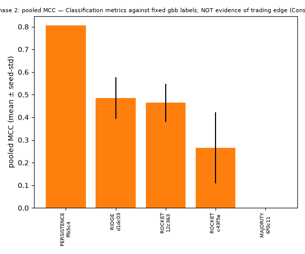
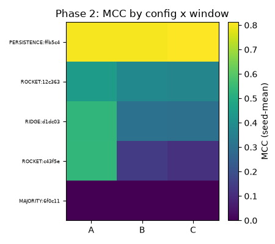
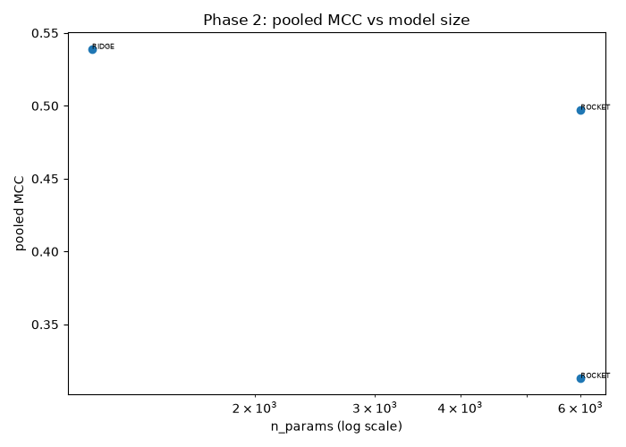
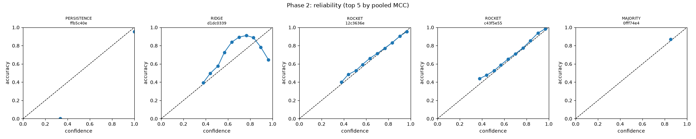

### Phase 3

## Table 1: pooled leaderboard (seed counts per config: PERSISTENCE=3, LSTM_K5=2, LSTM_W64=2, LSTM_KAN=2, LSTM_PONDER=2, LSTM_NOISY=2, LSTM_D10=2, LSTM_NORES=2, LSTM_NOCONV=2, LSTM_RAW=2, Transformer=2, LSTM=3, LSTM2=2, Multihead=2, GRU=2, Wavenet=3, Mamba2=3, LSTM_POOL=2, MLP=2, LSTM_INJIT=2, Attention=2, LSTM_NORESIZE=2, TSMamba=2, CNN=2, RIDGE=3, ROCKET=3, Mamba=2, ROCKET=3, MAJORITY=3)

| rank | arch | config_id | hp | input_set | seq_len | n_seeds | MCC | macro-F1 | bal-acc | logloss | ECE | AUROC macro | buy_prec@0.8 | buy_cov@0.8 | n_params | train (min) | infer ms (b256) | epochs_run | flags |
|---|---|---|---|---|---|---|---|---|---|---|---|---|---|---|---|---|---|---|---|
| 1 | PERSISTENCE | ffb5c40e8d6b | {} | ind24 | 16 | 3 | 0.805 ± 0.000 | 0.869 ± 0.000 | 0.869 ± 0.000 | 0.351 | 0.045 | 0.902 | 0.834 | 0.081 | 0 | 0.000 | NaN | 0.0 | baseline |
| 2 | LSTM_K5 | 48b806ceba9b | {} | ind24 | 16 | 2 | 0.662 ± 0.001 | 0.742 ± 0.001 | 0.951 ± 0.001 | 0.184 | 0.054 | 0.966 | 0.286 | 0.000 | 15555 | 3.529 | 0.003 | 39.5 | - |
| 3 | LSTM_W64 | e645063be7bc | {} | ind24 | 16 | 2 | 0.662 ± 0.000 | 0.742 ± 0.000 | 0.952 ± 0.003 | 0.180 | 0.051 | 0.967 | 0.699 | 0.002 | 47491 | 4.234 | 0.004 | 40.0 | - |
| 4 | LSTM_KAN | 3cd40f90604c | {} | ind24 | 16 | 2 | 0.653 ± 0.002 | 0.736 ± 0.002 | 0.940 ± 0.000 | 0.236 | 0.069 | 0.955 | 0.665 | 0.004 | 11907 | 5.372 | 0.003 | 40.0 | - |
| 5 | LSTM_PONDER | 59d72ed6d750 | {} | ind24 | 16 | 2 | 0.653 ± 0.001 | 0.736 ± 0.000 | 0.940 ± 0.001 | 0.229 | 0.065 | 0.954 | 0.143 | 0.000 | 14659 | 6.608 | 0.004 | 40.0 | - |
| 6 | LSTM_NOISY | 3a4ddb6c4092 | {} | ind24 | 16 | 2 | 0.652 ± 0.000 | 0.737 ± 0.001 | 0.948 ± 0.000 | 0.205 | 0.063 | 0.962 | 0.551 | 0.000 | 12483 | 7.268 | 0.006 | 40.0 | - |
| 7 | LSTM_D10 | 3d09879bf74b | {} | ind24 | 16 | 2 | 0.652 ± 0.000 | 0.737 ± 0.000 | 0.948 ± 0.002 | 0.205 | 0.063 | 0.963 | 0.798 | 0.001 | 12483 | 7.246 | 0.003 | 40.0 | - |
| 8 | LSTM_NORES | 558e2f29084d | {} | ind24 | 16 | 2 | 0.652 ± 0.000 | 0.737 ± 0.001 | 0.948 ± 0.001 | 0.201 | 0.061 | 0.963 | 0.734 | 0.000 | 12483 | 7.284 | 0.003 | 40.0 | - |
| 9 | LSTM_NOCONV | 470786990c9e | {} | ind24 | 16 | 2 | 0.651 ± 0.000 | 0.736 ± 0.000 | 0.949 ± 0.001 | 0.207 | 0.062 | 0.962 | 0.675 | 0.000 | 12483 | 6.150 | 0.003 | 36.5 | - |
| 10 | LSTM_RAW | 8d1446f2a484 | {} | ind24 | 16 | 2 | 0.650 ± 0.001 | 0.735 ± 0.001 | 0.948 ± 0.002 | 0.210 | 0.060 | 0.962 | 0.875 | 0.000 | 10539 | 4.201 | 0.002 | 29.5 | - |
| 11 | Transformer | cf6b6ccb530a | {} | ind24 | 16 | 2 | 0.649 ± 0.001 | 0.735 ± 0.001 | 0.942 ± 0.002 | 0.232 | 0.070 | 0.956 | 0.678 | 0.002 | 15587 | 8.485 | 0.005 | 35.5 | - |
| 12 | LSTM | d2bbc0d7fb15 | {} | ind24 | 16 | 3 | 0.649 ± 0.000 | 0.735 ± 0.000 | 0.941 ± 0.001 | 0.234 | 0.072 | 0.955 | 0.611 | 0.001 | 12483 | 7.682 | 0.003 | 40.0 | - |
| 13 | LSTM2 | 098ca2f95a2e | {} | ind24 | 16 | 2 | 0.649 ± 0.000 | 0.735 ± 0.000 | 0.940 ± 0.001 | 0.233 | 0.071 | 0.956 | 0.667 | 0.013 | 86787 | 14.348 | 0.006 | 37.8 | - |
| 14 | Multihead | 0b31c7bb9404 | {} | ind24 | 16 | 2 | 0.646 ± 0.001 | 0.734 ± 0.001 | 0.937 ± 0.002 | 0.232 | 0.069 | 0.956 | 0.725 | 0.007 | 12483 | 7.647 | 0.003 | 38.7 | - |
| 15 | GRU | f37089f602fe | {} | ind24 | 16 | 2 | 0.646 ± 0.000 | 0.733 ± 0.001 | 0.938 ± 0.001 | 0.233 | 0.068 | 0.955 | 0.658 | 0.010 | 142595 | 17.022 | 0.007 | 38.7 | - |
| 16 | Wavenet | 52292292ef8b | {} | ind24 | 16 | 3 | 0.646 ± 0.001 | 0.732 ± 0.001 | 0.938 ± 0.001 | 0.235 | 0.070 | 0.954 | 0.739 | 0.001 | 16227 | 5.768 | 0.002 | 40.0 | - |
| 17 | Mamba2 | 666675f56e77 | {} | ind24 | 16 | 3 | 0.641 ± 0.004 | 0.729 ± 0.003 | 0.934 ± 0.003 | 0.250 | 0.073 | 0.955 | 0.637 | 0.017 | 19407 | 10.801 | 0.005 | 38.0 | - |
| 18 | LSTM_POOL | d7fcd89ef3d6 | {} | ind24 | 16 | 2 | 0.640 ± 0.001 | 0.726 ± 0.000 | 0.932 ± 0.004 | 0.250 | 0.072 | 0.954 | 0.351 | 0.000 | 12483 | 5.591 | 0.003 | 40.0 | - |
| 19 | MLP | 60f40876941b | {} | ind24 | 16 | 2 | 0.640 ± 0.002 | 0.727 ± 0.002 | 0.936 ± 0.001 | 0.247 | 0.073 | 0.956 | 0.717 | 0.005 | 136515 | 3.762 | 0.001 | 38.0 | - |
| 20 | LSTM_INJIT | 0875fd5bd454 | {} | ind24 | 16 | 2 | 0.636 ± 0.001 | 0.731 ± 0.000 | 0.918 ± 0.003 | 0.213 | 0.049 | 0.961 | 0.742 | 0.000 | 12483 | 7.271 | 0.039 | 40.0 | - |
| 21 | Attention | ea8d90054291 | {} | ind24 | 16 | 2 | 0.612 ± 0.002 | 0.706 ± 0.002 | 0.924 ± 0.001 | 0.270 | 0.075 | 0.952 | 0.722 | 0.003 | 12483 | 6.514 | 0.003 | 40.0 | - |
| 22 | LSTM_NORESIZE | 225a954527c8 | {} | ind24 | 16 | 2 | 0.603 ± 0.000 | 0.715 ± 0.000 | 0.854 ± 0.001 | 0.219 | 0.047 | 0.956 | 0.717 | 0.001 | 10539 | 5.210 | 0.003 | 32.3 | - |
| 23 | TSMamba | f1f70fadabbb | {} | ind24 | 16 | 2 | 0.592 ± 0.003 | 0.707 ± 0.004 | 0.838 ± 0.009 | 0.231 | 0.057 | 0.954 | 0.598 | 0.023 | 37435 | 15.282 | 0.010 | 23.2 | - |
| 24 | CNN | 076666f04306 | {} | ind24 | 16 | 2 | 0.549 ± 0.003 | 0.663 ± 0.004 | 0.870 ± 0.003 | 0.458 | 0.052 | 0.941 | 0.619 | 0.034 | 2211 | 2.633 | 0.001 | 40.0 | - |
| 25 | RIDGE | d1dc0339b10b | {} | ind24 | 16 | 3 | 0.538 ± 0.002 | 0.658 ± 0.002 | 0.864 ± 0.002 | 0.556 | 0.153 | 0.937 | 0.588 | 0.036 | 1155 | 1.155 | 0.001 | 30.6 | baseline |
| 26 | ROCKET | 12c3636e7110 | {"feature_norm": "standardize"} | ind24 | 16 | 3 | 0.497 ± 0.029 | 0.633 ± 0.017 | 0.805 ± 0.061 | 0.465 | 0.053 | 0.929 | 0.592 | 0.040 | 6003 | 17.109 | 0.021 | 35.9 | baseline |
| 27 | Mamba | 9c5b1e952784 | {} | ind24 | 16 | 2 | 0.492 ± 0.049 | 0.601 ± 0.039 | 0.855 ± 0.010 | 0.807 | 0.160 | 0.889 | 0.368 | 0.089 | 21315 | 49.660 | 0.012 | 40.0 | - |
| 28 | ROCKET | c43f5e55fe61 | {} | ind24 | 16 | 3 | 0.313 ± 0.189 | 0.525 ± 0.132 | 0.575 ± 0.116 | 0.463 | 0.098 | 0.816 | 0.620 | 0.015 | 6003 | 5.326 | 0.023 | 14.8 | collapsed,baseline |
| 29 | MAJORITY | 6f0c110ce13c | {} | ind24 | 16 | 3 | 0.000 ± 0.000 | 0.310 ± 0.000 | 0.333 ± 0.000 | 0.482 | 0.037 | 0.500 | NaN | 0.000 | 0 | 0.000 | NaN | 0.0 | collapsed,baseline |

## Table 2: per-window MCC and macro-F1 (mean ± seed-std)

| arch | config_id | MCC A | MCC B | MCC C | macro-F1 A | macro-F1 B | macro-F1 C |
|---|---|---|---|---|---|---|---|
| PERSISTENCE | ffb5c40e8d6b | 0.801 ± 0.000 | 0.802 ± 0.000 | 0.812 ± 0.000 | 0.864 ± 0.000 | 0.868 ± 0.000 | 0.874 ± 0.000 |
| LSTM_K5 | 48b806ceba9b | 0.662 ± 0.001 | NaN ± NaN | NaN ± NaN | 0.742 ± 0.001 | NaN ± NaN | NaN ± NaN |
| LSTM_W64 | e645063be7bc | 0.662 ± 0.000 | NaN ± NaN | NaN ± NaN | 0.742 ± 0.000 | NaN ± NaN | NaN ± NaN |
| LSTM_KAN | 3cd40f90604c | 0.663 ± 0.002 | 0.643 ± NaN | NaN ± NaN | 0.743 ± 0.002 | 0.730 ± NaN | NaN ± NaN |
| LSTM_PONDER | 59d72ed6d750 | 0.665 ± 0.001 | 0.641 ± NaN | NaN ± NaN | 0.745 ± 0.000 | 0.728 ± NaN | NaN ± NaN |
| LSTM_NOISY | 3a4ddb6c4092 | 0.664 ± 0.000 | NaN ± NaN | 0.640 ± NaN | 0.744 ± 0.001 | NaN ± NaN | 0.730 ± NaN |
| LSTM_D10 | 3d09879bf74b | 0.663 ± 0.000 | NaN ± NaN | 0.640 ± NaN | 0.743 ± 0.000 | NaN ± NaN | 0.731 ± NaN |
| LSTM_NORES | 558e2f29084d | 0.664 ± 0.000 | NaN ± NaN | 0.640 ± NaN | 0.744 ± 0.001 | NaN ± NaN | 0.730 ± NaN |
| LSTM_NOCONV | 470786990c9e | 0.663 ± 0.000 | NaN ± NaN | 0.640 ± NaN | 0.743 ± 0.000 | NaN ± NaN | 0.730 ± NaN |
| LSTM_RAW | 8d1446f2a484 | 0.661 ± 0.001 | NaN ± NaN | 0.638 ± NaN | 0.741 ± 0.001 | NaN ± NaN | 0.728 ± NaN |
| Transformer | cf6b6ccb530a | 0.664 ± 0.003 | 0.642 ± 0.000 | 0.640 ± 0.000 | 0.745 ± 0.002 | 0.729 ± 0.000 | 0.731 ± 0.000 |
| LSTM | d2bbc0d7fb15 | 0.664 ± 0.001 | 0.642 ± 0.000 | 0.640 ± 0.000 | 0.744 ± 0.001 | 0.729 ± 0.000 | 0.731 ± 0.000 |
| LSTM2 | 098ca2f95a2e | 0.663 ± 0.000 | 0.643 ± 0.000 | 0.640 ± 0.000 | 0.744 ± 0.000 | 0.730 ± 0.001 | 0.730 ± 0.000 |
| Multihead | 0b31c7bb9404 | 0.659 ± 0.002 | 0.641 ± 0.001 | 0.639 ± 0.000 | 0.741 ± 0.002 | 0.729 ± 0.000 | 0.731 ± 0.000 |
| GRU | f37089f602fe | 0.661 ± 0.000 | 0.639 ± 0.000 | 0.639 ± 0.000 | 0.742 ± 0.002 | 0.727 ± 0.000 | 0.730 ± 0.000 |
| Wavenet | 52292292ef8b | 0.659 ± 0.002 | 0.640 ± 0.001 | 0.638 ± 0.001 | 0.740 ± 0.001 | 0.728 ± 0.000 | 0.729 ± 0.001 |
| Mamba2 | 666675f56e77 | 0.644 ± 0.011 | 0.639 ± 0.001 | 0.639 ± 0.001 | 0.730 ± 0.007 | 0.728 ± 0.002 | 0.730 ± 0.001 |
| LSTM_POOL | d7fcd89ef3d6 | 0.643 ± 0.001 | 0.637 ± NaN | NaN ± NaN | 0.727 ± 0.000 | 0.725 ± NaN | NaN ± NaN |
| MLP | 60f40876941b | 0.653 ± 0.001 | 0.634 ± 0.002 | 0.633 ± 0.002 | 0.735 ± 0.001 | 0.721 ± 0.002 | 0.724 ± 0.002 |
| LSTM_INJIT | 0875fd5bd454 | 0.650 ± 0.001 | NaN ± NaN | 0.622 ± NaN | 0.739 ± 0.000 | NaN ± NaN | 0.723 ± NaN |
| Attention | ea8d90054291 | 0.618 ± 0.005 | 0.601 ± 0.001 | 0.618 ± 0.001 | 0.709 ± 0.005 | 0.696 ± 0.001 | 0.713 ± 0.000 |
| LSTM_NORESIZE | 225a954527c8 | 0.663 ± 0.000 | 0.641 ± NaN | 0.504 ± NaN | 0.743 ± 0.000 | 0.728 ± NaN | 0.673 ± NaN |
| TSMamba | f1f70fadabbb | 0.502 ± 0.004 | 0.638 ± 0.002 | 0.636 ± 0.002 | 0.664 ± 0.009 | 0.728 ± 0.001 | 0.728 ± 0.002 |
| CNN | 076666f04306 | 0.555 ± 0.004 | 0.537 ± 0.004 | 0.555 ± 0.003 | 0.668 ± 0.006 | 0.653 ± 0.002 | 0.669 ± 0.002 |
| RIDGE | d1dc0339b10b | 0.533 ± 0.003 | 0.535 ± 0.000 | 0.547 ± 0.003 | 0.656 ± 0.003 | 0.652 ± 0.000 | 0.666 ± 0.002 |
| ROCKET | 12c3636e7110 | 0.450 ± 0.082 | 0.516 ± 0.003 | 0.526 ± 0.003 | 0.611 ± 0.048 | 0.638 ± 0.002 | 0.650 ± 0.002 |
| Mamba | 9c5b1e952784 | 0.513 ± 0.079 | 0.470 ± 0.019 | NaN ± NaN | 0.621 ± 0.064 | 0.581 ± 0.014 | NaN ± NaN |
| ROCKET | c43f5e55fe61 | 0.539 ± 0.006 | 0.214 ± 0.303 | 0.186 ± 0.256 | 0.671 ± 0.004 | 0.459 ± 0.221 | 0.446 ± 0.172 |
| MAJORITY | 6f0c110ce13c | 0.000 ± 0.000 | 0.000 ± 0.000 | 0.000 ± 0.000 | 0.315 ± 0.000 | 0.303 ± 0.000 | 0.311 ± 0.000 |

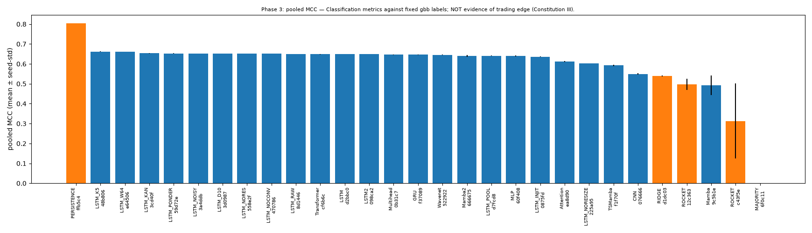
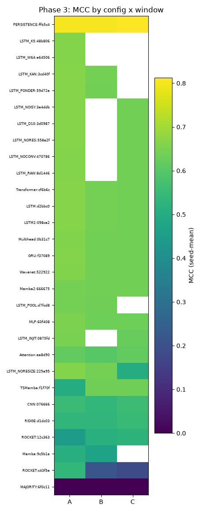
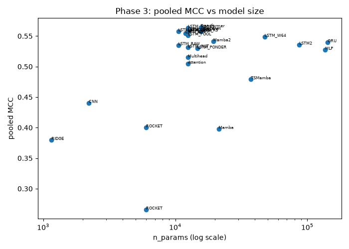
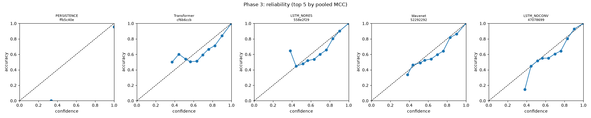

### Phase 4

## Table 1: pooled leaderboard (seed counts per config: PERSISTENCE=3, TRANSFORMER_FAM=2, TRANSFORMER_FAM=2, TRANSFORMER_FAM=2, TRANSFORMER_FAM=2, TRANSFORMER_FAM=2, TRANSFORMER_FAM=2, TRANSFORMER_FAM=2, TRANSFORMER_FAM=2, GRU_FAM=2, LSTM_FAM=2, TCN_FAM=2, TCN_FAM=2, TCN_FAM=2, LSTM_FAM=2, LSTM_FAM=2, MLP_FAM=2, MLP_FAM=2, GRU_FAM=2, LSTM_FAM=2, GRU_FAM=2, LSTM_FAM=2, GRU_FAM=2, MLP_FAM=2, MLP_FAM=2, TCN_FAM=2, GRU_FAM=2, MLP_FAM=2, TCN_FAM=2, GRU_FAM=2, TCN_FAM=2, LSTM_FAM=2, MLP_FAM=2, TRANSFORMER_FAM=2, TCN_FAM=2, TCN_FAM=2, GRU_FAM=2, LSTM_FAM=2, GRU_FAM=2, GRU_FAM=2, GRU_FAM=2, LSTM_FAM=2, LSTM_FAM=2, LSTM_FAM=2, RIDGE=3, GRU_FAM=2, GRU_FAM=2, LSTM_FAM=2, GRU_FAM=2, LSTM_FAM=2, LSTM_FAM=2, GRU_FAM=2, LSTM_FAM=2, GRU_FAM=2, ROCKET=3, LSTM_FAM=2, LSTM_FAM=2, ROCKET=3, MAJORITY=3, MAJORITY=3)

| rank | arch | config_id | hp | input_set | seq_len | n_seeds | MCC | macro-F1 | bal-acc | logloss | ECE | AUROC macro | buy_prec@0.8 | buy_cov@0.8 | n_params | train (min) | infer ms (b256) | epochs_run | flags |
|---|---|---|---|---|---|---|---|---|---|---|---|---|---|---|---|---|---|---|---|
| 1 | PERSISTENCE | ffb5c40e8d6b | {} | ind24 | 16 | 3 | 0.805 ± 0.000 | 0.869 ± 0.000 | 0.869 ± 0.000 | 0.351 | 0.045 | 0.902 | 0.834 | 0.081 | 0 | 0.000 | NaN | 0.0 | baseline |
| 2 | TRANSFORMER_FAM | bbbed50c3b5c | {"d_model": 64, "layers": 4} | ind24 | 16 | 2 | 0.648 ± 0.001 | 0.734 ± 0.001 | 0.941 ± 0.001 | 0.234 | 0.071 | 0.955 | 0.628 | 0.005 | 135683 | 10.939 | 0.009 | 34.3 | - |
| 3 | TRANSFORMER_FAM | 67ffa1f12fbd | {"d_model": 64} | ind24 | 16 | 2 | 0.648 ± 0.001 | 0.734 ± 0.001 | 0.941 ± 0.001 | 0.232 | 0.069 | 0.955 | 0.597 | 0.006 | 69251 | 6.341 | 0.005 | 35.2 | - |
| 4 | TRANSFORMER_FAM | 486f44b1f862 | {"d_model": 32} | ind24 | 16 | 2 | 0.647 ± 0.001 | 0.733 ± 0.001 | 0.942 ± 0.000 | 0.232 | 0.069 | 0.955 | 0.605 | 0.002 | 18243 | 5.770 | 0.005 | 38.5 | - |
| 5 | TRANSFORMER_FAM | 9278e1441b47 | {"d_model": 64, "heads": 8} | ind24 | 16 | 2 | 0.647 ± 0.002 | 0.733 ± 0.002 | 0.941 ± 0.001 | 0.232 | 0.069 | 0.955 | 0.619 | 0.004 | 69251 | 6.213 | 0.006 | 37.2 | - |
| 6 | TRANSFORMER_FAM | 6fe7246246f5 | {"d_model": 64, "ffn_mult": 4} | ind24 | 16 | 2 | 0.647 ± 0.001 | 0.734 ± 0.001 | 0.940 ± 0.002 | 0.228 | 0.066 | 0.955 | 0.601 | 0.003 | 102275 | 12.213 | 0.006 | 36.8 | - |
| 7 | TRANSFORMER_FAM | 821f46c115ab | {"d_model": 64, "layers": 1} | ind24 | 16 | 2 | 0.647 ± 0.001 | 0.733 ± 0.001 | 0.941 ± 0.001 | 0.234 | 0.067 | 0.955 | 0.601 | 0.006 | 36035 | 3.046 | 0.003 | 36.3 | - |
| 8 | TRANSFORMER_FAM | 3413d77700b0 | {"d_model": 64, "pos": "rope"} | ind24 | 16 | 2 | 0.646 ± 0.000 | 0.733 ± 0.001 | 0.939 ± 0.001 | 0.230 | 0.068 | 0.955 | 0.614 | 0.004 | 68739 | 6.439 | 0.006 | 34.7 | - |
| 9 | TRANSFORMER_FAM | d5a1481bd4c0 | {"d_model": 128} | ind24 | 16 | 2 | 0.646 ± 0.001 | 0.732 ± 0.001 | 0.939 ± 0.001 | 0.232 | 0.067 | 0.953 | 0.588 | 0.004 | 269571 | 8.313 | 0.007 | 32.0 | - |
| 10 | GRU_FAM | cef2eef58d6b | {"depth": 2, "hidden": 64, "input_norm": false} | ind24 | 16 | 2 | 0.644 ± 0.001 | 0.731 ± 0.001 | 0.938 ± 0.001 | 0.244 | 0.067 | 0.955 | 0.625 | 0.012 | 42307 | 6.112 | 0.005 | 39.0 | - |
| 11 | LSTM_FAM | b690297cbbf5 | {"depth": 2, "hidden": 64, "input_norm": false} | ind24 | 16 | 2 | 0.644 ± 0.001 | 0.731 ± 0.000 | 0.937 ± 0.000 | 0.237 | 0.067 | 0.956 | 0.602 | 0.012 | 56131 | 5.754 | 0.004 | 38.2 | - |
| 12 | TCN_FAM | 318ea175aa05 | {"channels": 64, "depth": 6} | ind24 | 16 | 2 | 0.643 ± 0.001 | 0.729 ± 0.001 | 0.937 ± 0.001 | 0.285 | 0.094 | 0.954 | 0.600 | 0.009 | 66627 | 2.623 | 0.002 | 40.0 | - |
| 13 | TCN_FAM | a09a0b24d6fe | {"channels": 64} | ind24 | 16 | 2 | 0.641 ± 0.001 | 0.728 ± 0.001 | 0.935 ± 0.001 | 0.322 | 0.088 | 0.954 | 0.587 | 0.021 | 29571 | 1.792 | 0.002 | 40.0 | - |
| 14 | TCN_FAM | f7d18cb3a30f | {"channels": 64, "depth": 4, "dilation_base": 2} | ind24 | 16 | 2 | 0.641 ± 0.001 | 0.727 ± 0.001 | 0.937 ± 0.001 | 0.253 | 0.078 | 0.954 | 0.655 | 0.002 | 41923 | 2.656 | 0.002 | 40.0 | - |
| 15 | LSTM_FAM | 7b50342154ef | {"hidden": 64, "input_norm": false} | ind24 | 16 | 2 | 0.640 ± 0.001 | 0.727 ± 0.001 | 0.935 ± 0.002 | 0.248 | 0.061 | 0.955 | 0.610 | 0.011 | 23107 | 3.112 | 0.003 | 36.0 | - |
| 16 | LSTM_FAM | f5be6cc3a0df | {"bidirectional": true, "hidden": 64, "input_norm": false} | ind24 | 16 | 2 | 0.640 ± 0.001 | 0.727 ± 0.002 | 0.935 ± 0.001 | 0.246 | 0.061 | 0.955 | 0.602 | 0.011 | 46211 | 5.772 | 0.004 | 37.2 | - |
| 17 | MLP_FAM | e5974774aa5f | {"width": 64} | ind24 | 16 | 2 | 0.639 ± 0.003 | 0.727 ± 0.002 | 0.933 ± 0.002 | 0.242 | 0.068 | 0.955 | 0.765 | 0.002 | 28995 | 1.042 | 0.001 | 40.0 | - |
| 18 | MLP_FAM | b8285305a779 | {"width": 128} | ind24 | 16 | 2 | 0.639 ± 0.001 | 0.727 ± 0.001 | 0.932 ± 0.001 | 0.240 | 0.067 | 0.955 | 0.667 | 0.004 | 66179 | 1.053 | 0.001 | 38.8 | - |
| 19 | GRU_FAM | 551b8bb6dcf2 | {"hidden": 32, "input_norm": false} | ind24 | 16 | 2 | 0.639 ± 0.000 | 0.726 ± 0.000 | 0.935 ± 0.001 | 0.254 | 0.063 | 0.954 | 0.621 | 0.010 | 5667 | 3.382 | 0.003 | 39.5 | - |
| 20 | LSTM_FAM | 5616ab5d0bd0 | {"hidden": 16, "input_norm": false} | ind24 | 16 | 2 | 0.638 ± 0.002 | 0.725 ± 0.001 | 0.937 ± 0.002 | 0.256 | 0.062 | 0.953 | 0.580 | 0.011 | 2707 | 2.758 | 0.002 | 37.8 | - |
| 21 | GRU_FAM | 3c120e544d4e | {"bidirectional": true, "hidden": 64, "input_norm": false} | ind24 | 16 | 2 | 0.638 ± 0.001 | 0.726 ± 0.002 | 0.934 ± 0.002 | 0.257 | 0.060 | 0.954 | 0.615 | 0.014 | 34947 | 5.414 | 0.004 | 35.3 | - |
| 22 | LSTM_FAM | 4c265676afae | {"hidden": 32, "input_norm": false} | ind24 | 16 | 2 | 0.637 ± 0.001 | 0.724 ± 0.001 | 0.936 ± 0.001 | 0.255 | 0.062 | 0.954 | 0.599 | 0.012 | 7459 | 2.887 | 0.002 | 37.5 | - |
| 23 | GRU_FAM | 70eb48f9acfb | {"hidden": 64, "input_norm": false} | ind24 | 16 | 2 | 0.636 ± 0.001 | 0.725 ± 0.001 | 0.932 ± 0.002 | 0.258 | 0.063 | 0.954 | 0.623 | 0.010 | 17475 | 3.060 | 0.003 | 35.7 | - |
| 24 | MLP_FAM | 4a28d1ce4ebd | {"depth": 3, "width": 256} | ind24 | 16 | 2 | 0.636 ± 0.002 | 0.726 ± 0.001 | 0.928 ± 0.002 | 0.240 | 0.067 | 0.955 | 0.699 | 0.005 | 230915 | 1.311 | 0.001 | 39.5 | - |
| 25 | MLP_FAM | 8e1f1550ad56 | {"width": 256} | ind24 | 16 | 2 | 0.636 ± 0.001 | 0.726 ± 0.001 | 0.928 ± 0.001 | 0.240 | 0.067 | 0.955 | 0.641 | 0.009 | 165123 | 1.130 | 0.001 | 38.2 | - |
| 26 | TCN_FAM | b85e94f80dc6 | {"channels": 256} | ind24 | 16 | 2 | 0.636 ± 0.002 | 0.726 ± 0.000 | 0.926 ± 0.004 | 0.297 | 0.078 | 0.953 | 0.577 | 0.031 | 413187 | 4.929 | 0.004 | 36.3 | - |
| 27 | GRU_FAM | 702b00fcb20c | {"hidden": 16, "input_norm": false} | ind24 | 16 | 2 | 0.635 ± 0.002 | 0.723 ± 0.002 | 0.936 ± 0.001 | 0.263 | 0.064 | 0.953 | 0.586 | 0.010 | 2067 | 3.356 | 0.003 | 39.7 | - |
| 28 | MLP_FAM | 1260944a8d42 | {"depth": 1, "width": 256} | ind24 | 16 | 2 | 0.635 ± 0.001 | 0.728 ± 0.001 | 0.923 ± 0.002 | 0.243 | 0.061 | 0.954 | 0.618 | 0.018 | 99331 | 0.934 | 0.001 | 38.3 | - |
| 29 | TCN_FAM | 12af479dfaa3 | {"channels": 64, "kernel": 5} | ind24 | 16 | 2 | 0.635 ± 0.001 | 0.724 ± 0.001 | 0.930 ± 0.003 | 0.300 | 0.078 | 0.953 | 0.580 | 0.017 | 49027 | 1.944 | 0.002 | 39.5 | - |
| 30 | GRU_FAM | 68c1f710246f | {"hidden": 256, "input_norm": false} | ind24 | 16 | 2 | 0.633 ± 0.000 | 0.722 ± 0.001 | 0.930 ± 0.002 | 0.259 | 0.063 | 0.954 | 0.613 | 0.020 | 217347 | 7.610 | 0.006 | 31.5 | - |
| 31 | TCN_FAM | 8a9bbc798cf3 | {"channels": 32} | ind24 | 16 | 2 | 0.633 ± 0.001 | 0.723 ± 0.001 | 0.930 ± 0.002 | 0.353 | 0.081 | 0.952 | 0.601 | 0.017 | 8643 | 1.403 | 0.001 | 40.0 | - |
| 32 | LSTM_FAM | b5b58a6c2cc5 | {"hidden": 256, "input_norm": false} | ind24 | 16 | 2 | 0.631 ± 0.001 | 0.722 ± 0.001 | 0.927 ± 0.001 | 0.274 | 0.071 | 0.948 | 0.580 | 0.017 | 289027 | 17.709 | 0.005 | 32.2 | - |
| 33 | MLP_FAM | 9c94bdef2a2d | {"width": 1024} | ind24 | 16 | 2 | 0.630 ± 0.002 | 0.723 ± 0.001 | 0.922 ± 0.003 | 0.244 | 0.062 | 0.953 | 0.616 | 0.014 | 1446915 | 1.947 | 0.001 | 32.2 | - |
| 34 | TRANSFORMER_FAM | a4fb5eb48337 | {"d_model": 64, "pos": "none"} | ind24 | 16 | 2 | 0.624 ± 0.005 | 0.716 ± 0.003 | 0.920 ± 0.003 | 0.253 | 0.068 | 0.952 | 0.613 | 0.010 | 68227 | 10.636 | 0.005 | 39.2 | - |
| 35 | TCN_FAM | fa4e5ad070f7 | {"channels": 64, "depth": 2} | ind24 | 16 | 2 | 0.617 ± 0.001 | 0.710 ± 0.001 | 0.919 ± 0.001 | 0.336 | 0.048 | 0.952 | 0.615 | 0.017 | 17219 | 1.382 | 0.001 | 40.0 | - |
| 36 | TCN_FAM | dbd824e7736c | {"channels": 16} | ind24 | 16 | 2 | 0.611 ± 0.003 | 0.708 ± 0.002 | 0.911 ± 0.004 | 0.394 | 0.073 | 0.949 | 0.611 | 0.011 | 2787 | 1.305 | 0.001 | 40.0 | - |
| 37 | GRU_FAM | c6a3d0fd6d2d | {"depth": 2, "hidden": 64} | ind24 | 16 | 2 | 0.574 ± 0.000 | 0.696 ± 0.002 | 0.808 ± 0.004 | 0.230 | 0.032 | 0.954 | 0.643 | 0.004 | 42179 | 2.772 | 0.005 | 27.8 | - |
| 38 | LSTM_FAM | f12de4f7b017 | {"hidden": 64} | ind24 | 16 | 2 | 0.563 ± 0.009 | 0.692 ± 0.006 | 0.798 ± 0.012 | 0.223 | 0.030 | 0.954 | 0.602 | 0.004 | 23155 | 1.747 | 0.003 | 27.8 | - |
| 39 | GRU_FAM | 1f2b114246b7 | {"depth": 2, "hidden": 64} | ind24 | 16 | 2 | 0.550 ± 0.007 | 0.690 ± 0.006 | 0.768 ± 0.013 | 0.212 | 0.026 | 0.955 | 0.592 | 0.003 | 42355 | 2.977 | 0.006 | 21.8 | - |
| 40 | GRU_FAM | ea594d5a1a9e | {"hidden": 64} | ind24 | 16 | 2 | 0.549 ± 0.005 | 0.692 ± 0.001 | 0.772 ± 0.001 | 0.216 | 0.026 | 0.954 | 0.616 | 0.003 | 17523 | 2.292 | 0.004 | 26.2 | - |
| 41 | GRU_FAM | a7457da86656 | {"bidirectional": true, "hidden": 64} | ind24 | 16 | 2 | 0.545 ± 0.013 | 0.687 ± 0.008 | 0.762 ± 0.018 | 0.216 | 0.023 | 0.955 | 0.616 | 0.004 | 34995 | 2.752 | 0.005 | 20.0 | - |
| 42 | LSTM_FAM | b558515c6d2c | {"bidirectional": true, "hidden": 64} | ind24 | 16 | 2 | 0.543 ± 0.012 | 0.685 ± 0.010 | 0.756 ± 0.018 | 0.211 | 0.022 | 0.955 | 0.633 | 0.002 | 46259 | 2.952 | 0.004 | 21.5 | - |
| 43 | LSTM_FAM | ed95eafb5053 | {"depth": 2, "hidden": 64} | ind24 | 16 | 2 | 0.542 ± 0.004 | 0.687 ± 0.001 | 0.754 ± 0.004 | 0.210 | 0.020 | 0.956 | 0.657 | 0.002 | 56003 | 3.974 | 0.004 | 29.3 | - |
| 44 | LSTM_FAM | 128c3f1c31d8 | {"depth": 2, "hidden": 64} | ind24 | 16 | 2 | 0.541 ± 0.010 | 0.686 ± 0.007 | 0.758 ± 0.014 | 0.211 | 0.026 | 0.954 | 0.615 | 0.004 | 56179 | 3.265 | 0.005 | 22.5 | - |
| 45 | RIDGE | d1dc0339b10b | {} | ind24 | 16 | 3 | 0.539 ± 0.003 | 0.659 ± 0.003 | 0.864 ± 0.002 | 0.555 | 0.154 | 0.937 | 0.588 | 0.036 | 1155 | 1.245 | 0.001 | 32.1 | baseline |
| 46 | GRU_FAM | c1f46501f6a0 | {"hidden": 256} | ind24 | 16 | 2 | 0.537 ± 0.012 | 0.681 ± 0.011 | 0.747 ± 0.020 | 0.222 | 0.022 | 0.955 | 0.659 | 0.005 | 216835 | 5.362 | 0.006 | 22.5 | - |
| 47 | GRU_FAM | 9637450c6593 | {"hidden": 256} | ind24 | 16 | 2 | 0.537 ± 0.005 | 0.683 ± 0.005 | 0.753 ± 0.011 | 0.220 | 0.023 | 0.954 | 0.625 | 0.003 | 217395 | 3.562 | 0.006 | 15.3 | - |
| 48 | LSTM_FAM | 248fd1539819 | {"hidden": 16} | ind24 | 16 | 2 | 0.535 ± 0.004 | 0.678 ± 0.005 | 0.747 ± 0.008 | 0.213 | 0.021 | 0.954 | 0.640 | 0.002 | 2755 | 1.740 | 0.003 | 26.3 | - |
| 49 | GRU_FAM | 053da6234557 | {"hidden": 16} | ind24 | 16 | 2 | 0.526 ± 0.007 | 0.671 ± 0.008 | 0.738 ± 0.011 | 0.216 | 0.021 | 0.954 | 0.659 | 0.001 | 2115 | 1.815 | 0.003 | 24.3 | - |
| 50 | LSTM_FAM | 0727d8e81d1b | {"bidirectional": true, "hidden": 64} | ind24 | 16 | 2 | 0.524 ± 0.008 | 0.669 ± 0.006 | 0.733 ± 0.006 | 0.225 | 0.020 | 0.955 | 0.660 | 0.003 | 45955 | 3.500 | 0.004 | 26.3 | - |
| 51 | LSTM_FAM | 1804839ab883 | {"hidden": 64} | ind24 | 16 | 2 | 0.523 ± 0.005 | 0.667 ± 0.006 | 0.729 ± 0.009 | 0.222 | 0.020 | 0.954 | 0.637 | 0.002 | 22979 | 1.893 | 0.003 | 25.8 | - |
| 52 | GRU_FAM | 265588001083 | {"hidden": 64} | ind24 | 16 | 2 | 0.521 ± 0.006 | 0.667 ± 0.005 | 0.731 ± 0.008 | 0.232 | 0.024 | 0.954 | 0.673 | 0.004 | 17347 | 1.879 | 0.003 | 25.3 | - |
| 53 | LSTM_FAM | 88268c05998b | {"hidden": 16} | ind24 | 16 | 2 | 0.510 ± 0.002 | 0.651 ± 0.001 | 0.712 ± 0.002 | 0.227 | 0.019 | 0.954 | 0.609 | 0.001 | 2675 | 1.624 | 0.002 | 26.2 | - |
| 54 | GRU_FAM | 5fa2b2e33ecb | {"hidden": 16} | ind24 | 16 | 2 | 0.505 ± 0.004 | 0.653 ± 0.001 | 0.712 ± 0.003 | 0.245 | 0.026 | 0.953 | 0.695 | 0.004 | 2035 | 1.769 | 0.003 | 25.5 | - |
| 55 | ROCKET | 12c3636e7110 | {"feature_norm": "standardize"} | ind24 | 16 | 3 | 0.497 ± 0.029 | 0.633 ± 0.017 | 0.805 ± 0.061 | 0.466 | 0.054 | 0.929 | 0.591 | 0.040 | 6003 | 15.791 | 0.022 | 34.6 | baseline |
| 56 | LSTM_FAM | 8f8526a69864 | {"hidden": 256} | ind24 | 16 | 2 | 0.487 ± 0.015 | 0.663 ± 0.009 | 0.667 ± 0.019 | 0.227 | 0.022 | 0.948 | 0.612 | 0.009 | 289075 | 4.625 | 0.006 | 13.5 | - |
| 57 | LSTM_FAM | 51b427ea03a3 | {"hidden": 256} | ind24 | 16 | 2 | 0.486 ± 0.014 | 0.659 ± 0.008 | 0.661 ± 0.017 | 0.224 | 0.015 | 0.949 | 0.661 | 0.004 | 288515 | 7.914 | 0.005 | 17.2 | - |
| 58 | ROCKET | c43f5e55fe61 | {} | ind24 | 16 | 3 | 0.313 ± 0.189 | 0.525 ± 0.132 | 0.575 ± 0.116 | 0.463 | 0.098 | 0.816 | 0.620 | 0.015 | 6003 | 5.326 | 0.023 | 14.8 | collapsed,baseline |
| 59 | MAJORITY | 6f0c110ce13c | {} | ind24 | 16 | 3 | 0.000 ± 0.000 | 0.310 ± 0.000 | 0.333 ± 0.000 | 0.482 | 0.037 | 0.500 | NaN | 0.000 | 0 | 0.000 | NaN | 0.0 | collapsed,baseline |
| 60 | MAJORITY | 0fff74e44056 | {} | ind24 | 16 | 3 | 0.000 ± 0.000 | 0.310 ± 0.000 | 0.333 ± 0.000 | 0.482 | 0.037 | 0.500 | NaN | 0.000 | 0 | 0.000 | NaN | 0.0 | collapsed,baseline |

## Table 2: per-window MCC and macro-F1 (mean ± seed-std)

| arch | config_id | MCC A | MCC B | MCC C | macro-F1 A | macro-F1 B | macro-F1 C |
|---|---|---|---|---|---|---|---|
| PERSISTENCE | ffb5c40e8d6b | 0.801 ± 0.000 | 0.802 ± 0.000 | 0.812 ± 0.000 | 0.864 ± 0.000 | 0.868 ± 0.000 | 0.874 ± 0.000 |
| TRANSFORMER_FAM | bbbed50c3b5c | 0.664 ± 0.000 | 0.640 ± 0.001 | 0.640 ± 0.000 | 0.744 ± 0.001 | 0.727 ± 0.002 | 0.730 ± 0.000 |
| TRANSFORMER_FAM | 67ffa1f12fbd | 0.664 ± 0.001 | 0.641 ± 0.000 | 0.638 ± 0.002 | 0.744 ± 0.001 | 0.728 ± 0.000 | 0.729 ± 0.001 |
| TRANSFORMER_FAM | 486f44b1f862 | 0.662 ± 0.002 | 0.641 ± 0.000 | 0.639 ± 0.000 | 0.742 ± 0.002 | 0.728 ± 0.000 | 0.729 ± 0.000 |
| TRANSFORMER_FAM | 9278e1441b47 | 0.662 ± 0.003 | 0.640 ± 0.001 | 0.640 ± 0.001 | 0.743 ± 0.003 | 0.728 ± 0.001 | 0.730 ± 0.001 |
| TRANSFORMER_FAM | 6fe7246246f5 | 0.663 ± 0.003 | 0.640 ± 0.000 | 0.639 ± 0.001 | 0.744 ± 0.002 | 0.728 ± 0.000 | 0.729 ± 0.001 |
| TRANSFORMER_FAM | 821f46c115ab | 0.662 ± 0.002 | 0.640 ± 0.000 | 0.639 ± 0.000 | 0.742 ± 0.001 | 0.727 ± 0.001 | 0.730 ± 0.000 |
| TRANSFORMER_FAM | 3413d77700b0 | 0.660 ± 0.000 | 0.640 ± 0.001 | 0.638 ± 0.000 | 0.742 ± 0.001 | 0.727 ± 0.001 | 0.729 ± 0.000 |
| TRANSFORMER_FAM | d5a1481bd4c0 | 0.661 ± 0.003 | 0.639 ± 0.000 | 0.637 ± 0.001 | 0.742 ± 0.002 | 0.727 ± 0.000 | 0.727 ± 0.001 |
| GRU_FAM | cef2eef58d6b | 0.658 ± 0.001 | 0.637 ± 0.001 | 0.637 ± 0.001 | 0.740 ± 0.001 | 0.724 ± 0.001 | 0.728 ± 0.001 |
| LSTM_FAM | b690297cbbf5 | 0.657 ± 0.001 | 0.638 ± 0.001 | 0.637 ± 0.000 | 0.738 ± 0.000 | 0.725 ± 0.000 | 0.729 ± 0.000 |
| TCN_FAM | 318ea175aa05 | 0.656 ± 0.002 | 0.635 ± 0.000 | 0.638 ± 0.000 | 0.737 ± 0.002 | 0.722 ± 0.001 | 0.728 ± 0.000 |
| TCN_FAM | a09a0b24d6fe | 0.650 ± 0.001 | 0.634 ± 0.001 | 0.637 ± 0.001 | 0.734 ± 0.001 | 0.723 ± 0.001 | 0.728 ± 0.000 |
| TCN_FAM | f7d18cb3a30f | 0.649 ± 0.002 | 0.636 ± 0.001 | 0.637 ± 0.001 | 0.733 ± 0.001 | 0.723 ± 0.001 | 0.727 ± 0.001 |
| LSTM_FAM | 7b50342154ef | 0.654 ± 0.001 | 0.632 ± 0.001 | 0.634 ± 0.001 | 0.736 ± 0.002 | 0.721 ± 0.000 | 0.725 ± 0.001 |
| LSTM_FAM | f5be6cc3a0df | 0.655 ± 0.001 | 0.631 ± 0.002 | 0.634 ± 0.000 | 0.737 ± 0.002 | 0.720 ± 0.002 | 0.725 ± 0.001 |
| MLP_FAM | e5974774aa5f | 0.651 ± 0.002 | 0.632 ± 0.003 | 0.633 ± 0.004 | 0.735 ± 0.001 | 0.721 ± 0.003 | 0.724 ± 0.003 |
| MLP_FAM | b8285305a779 | 0.649 ± 0.003 | 0.633 ± 0.001 | 0.635 ± 0.000 | 0.734 ± 0.003 | 0.722 ± 0.001 | 0.726 ± 0.000 |
| GRU_FAM | 551b8bb6dcf2 | 0.651 ± 0.000 | 0.631 ± 0.000 | 0.634 ± 0.000 | 0.735 ± 0.000 | 0.719 ± 0.000 | 0.724 ± 0.001 |
| LSTM_FAM | 5616ab5d0bd0 | 0.652 ± 0.001 | 0.630 ± 0.002 | 0.633 ± 0.001 | 0.734 ± 0.000 | 0.718 ± 0.002 | 0.724 ± 0.001 |
| GRU_FAM | 3c120e544d4e | 0.652 ± 0.001 | 0.629 ± 0.001 | 0.632 ± 0.002 | 0.736 ± 0.003 | 0.718 ± 0.002 | 0.724 ± 0.002 |
| LSTM_FAM | 4c265676afae | 0.650 ± 0.001 | 0.630 ± 0.001 | 0.633 ± 0.002 | 0.731 ± 0.001 | 0.718 ± 0.001 | 0.724 ± 0.002 |
| GRU_FAM | 70eb48f9acfb | 0.651 ± 0.000 | 0.627 ± 0.002 | 0.630 ± 0.002 | 0.735 ± 0.001 | 0.717 ± 0.001 | 0.722 ± 0.001 |
| MLP_FAM | 4a28d1ce4ebd | 0.647 ± 0.001 | 0.628 ± 0.003 | 0.633 ± 0.001 | 0.734 ± 0.000 | 0.719 ± 0.003 | 0.726 ± 0.001 |
| MLP_FAM | 8e1f1550ad56 | 0.646 ± 0.002 | 0.629 ± 0.000 | 0.634 ± 0.001 | 0.733 ± 0.002 | 0.720 ± 0.000 | 0.726 ± 0.001 |
| TCN_FAM | b85e94f80dc6 | 0.642 ± 0.004 | 0.632 ± 0.001 | 0.633 ± 0.000 | 0.732 ± 0.000 | 0.723 ± 0.001 | 0.725 ± 0.000 |
| GRU_FAM | 702b00fcb20c | 0.646 ± 0.004 | 0.628 ± 0.001 | 0.632 ± 0.001 | 0.730 ± 0.005 | 0.716 ± 0.001 | 0.723 ± 0.001 |
| MLP_FAM | 1260944a8d42 | 0.644 ± 0.002 | 0.629 ± 0.000 | 0.632 ± 0.001 | 0.735 ± 0.001 | 0.721 ± 0.000 | 0.727 ± 0.000 |
| TCN_FAM | 12af479dfaa3 | 0.642 ± 0.003 | 0.631 ± 0.001 | 0.633 ± 0.000 | 0.728 ± 0.001 | 0.719 ± 0.001 | 0.724 ± 0.000 |
| GRU_FAM | 68c1f710246f | 0.647 ± 0.000 | 0.624 ± 0.000 | 0.627 ± 0.001 | 0.732 ± 0.001 | 0.715 ± 0.001 | 0.720 ± 0.001 |
| TCN_FAM | 8a9bbc798cf3 | 0.639 ± 0.001 | 0.627 ± 0.001 | 0.633 ± 0.000 | 0.726 ± 0.001 | 0.717 ± 0.001 | 0.725 ± 0.000 |
| LSTM_FAM | b5b58a6c2cc5 | NaN ± NaN | 0.631 ± 0.000 | 0.630 ± 0.001 | NaN ± NaN | 0.721 ± 0.001 | 0.722 ± 0.001 |
| MLP_FAM | 9c94bdef2a2d | 0.639 ± 0.002 | 0.623 ± 0.003 | 0.628 ± 0.001 | 0.727 ± 0.001 | 0.718 ± 0.000 | 0.723 ± 0.003 |
| TRANSFORMER_FAM | a4fb5eb48337 | 0.627 ± 0.010 | 0.619 ± 0.002 | 0.625 ± 0.003 | 0.717 ± 0.007 | 0.712 ± 0.000 | 0.718 ± 0.003 |
| TCN_FAM | fa4e5ad070f7 | 0.626 ± 0.001 | 0.610 ± 0.002 | 0.615 ± 0.001 | 0.717 ± 0.001 | 0.705 ± 0.002 | 0.709 ± 0.001 |
| TCN_FAM | dbd824e7736c | 0.616 ± 0.002 | 0.602 ± 0.004 | 0.613 ± 0.004 | 0.710 ± 0.001 | 0.701 ± 0.003 | 0.712 ± 0.003 |
| GRU_FAM | c6a3d0fd6d2d | 0.646 ± 0.000 | 0.501 ± NaN | NaN ± NaN | 0.730 ± 0.002 | 0.663 ± NaN | NaN ± NaN |
| LSTM_FAM | f12de4f7b017 | 0.648 ± 0.001 | 0.478 ± 0.016 | NaN ± NaN | 0.732 ± 0.001 | 0.652 ± 0.010 | NaN ± NaN |
| GRU_FAM | 1f2b114246b7 | 0.651 ± 0.000 | 0.492 ± 0.012 | 0.506 ± 0.007 | 0.735 ± 0.000 | 0.660 ± 0.012 | 0.676 ± 0.006 |
| GRU_FAM | ea594d5a1a9e | 0.647 ± 0.000 | 0.497 ± 0.008 | 0.504 ± 0.007 | 0.730 ± 0.000 | 0.668 ± 0.001 | 0.677 ± 0.001 |
| GRU_FAM | a7457da86656 | 0.647 ± 0.001 | 0.487 ± 0.012 | 0.501 ± 0.026 | 0.731 ± 0.001 | 0.661 ± 0.000 | 0.670 ± 0.022 |
| LSTM_FAM | b558515c6d2c | 0.651 ± 0.001 | 0.474 ± 0.016 | 0.505 ± 0.019 | 0.734 ± 0.001 | 0.646 ± 0.016 | 0.673 ± 0.014 |
| LSTM_FAM | ed95eafb5053 | 0.652 ± 0.001 | 0.466 ± 0.009 | 0.510 ± 0.002 | 0.735 ± 0.000 | 0.647 ± 0.002 | 0.679 ± 0.000 |
| LSTM_FAM | 128c3f1c31d8 | 0.651 ± 0.000 | 0.471 ± 0.007 | 0.499 ± 0.023 | 0.734 ± 0.001 | 0.650 ± 0.004 | 0.673 ± 0.017 |
| RIDGE | d1dc0339b10b | 0.533 ± 0.003 | 0.537 ± 0.003 | 0.547 ± 0.002 | 0.656 ± 0.003 | 0.654 ± 0.003 | 0.666 ± 0.001 |
| GRU_FAM | c1f46501f6a0 | 0.640 ± 0.000 | 0.480 ± 0.022 | 0.492 ± 0.014 | 0.728 ± 0.000 | 0.649 ± 0.021 | 0.665 ± 0.011 |
| GRU_FAM | 9637450c6593 | 0.642 ± 0.002 | 0.480 ± 0.009 | 0.489 ± 0.005 | 0.727 ± 0.001 | 0.654 ± 0.007 | 0.667 ± 0.005 |
| LSTM_FAM | 248fd1539819 | 0.647 ± 0.002 | 0.473 ± 0.002 | 0.484 ± 0.009 | 0.730 ± 0.002 | 0.644 ± 0.005 | 0.659 ± 0.008 |
| GRU_FAM | 053da6234557 | 0.643 ± 0.000 | 0.457 ± 0.006 | 0.478 ± 0.015 | 0.726 ± 0.000 | 0.633 ± 0.005 | 0.652 ± 0.017 |
| LSTM_FAM | 0727d8e81d1b | 0.635 ± 0.012 | 0.459 ± 0.002 | 0.479 ± 0.009 | 0.720 ± 0.010 | 0.635 ± 0.003 | 0.653 ± 0.005 |
| LSTM_FAM | 1804839ab883 | 0.639 ± 0.003 | 0.460 ± 0.002 | 0.471 ± 0.011 | 0.724 ± 0.000 | 0.634 ± 0.004 | 0.643 ± 0.012 |
| GRU_FAM | 265588001083 | 0.630 ± 0.001 | 0.457 ± 0.015 | 0.477 ± 0.002 | 0.716 ± 0.000 | 0.633 ± 0.010 | 0.652 ± 0.005 |
| LSTM_FAM | 88268c05998b | 0.632 ± 0.000 | 0.443 ± 0.004 | 0.456 ± 0.001 | 0.717 ± 0.000 | 0.616 ± 0.002 | 0.620 ± 0.003 |
| GRU_FAM | 5fa2b2e33ecb | 0.619 ± 0.000 | 0.443 ± 0.006 | 0.453 ± 0.007 | 0.708 ± 0.000 | 0.623 ± 0.001 | 0.629 ± 0.003 |
| ROCKET | 12c3636e7110 | 0.450 ± 0.082 | 0.516 ± 0.002 | 0.526 ± 0.002 | 0.611 ± 0.048 | 0.638 ± 0.002 | 0.649 ± 0.001 |
| LSTM_FAM | 8f8526a69864 | NaN ± NaN | 0.479 ± 0.012 | 0.496 ± 0.018 | NaN ± NaN | 0.659 ± 0.005 | 0.668 ± 0.014 |
| LSTM_FAM | 51b427ea03a3 | NaN ± NaN | 0.476 ± 0.021 | 0.496 ± 0.006 | NaN ± NaN | 0.650 ± 0.009 | 0.669 ± 0.008 |
| ROCKET | c43f5e55fe61 | 0.539 ± 0.006 | 0.214 ± 0.303 | 0.186 ± 0.256 | 0.671 ± 0.004 | 0.459 ± 0.221 | 0.446 ± 0.172 |
| MAJORITY | 6f0c110ce13c | 0.000 ± 0.000 | 0.000 ± 0.000 | 0.000 ± 0.000 | 0.315 ± 0.000 | 0.303 ± 0.000 | 0.311 ± 0.000 |
| MAJORITY | 0fff74e44056 | 0.000 ± 0.000 | 0.000 ± 0.000 | 0.000 ± NaN | 0.315 ± 0.000 | 0.303 ± 0.000 | 0.311 ± NaN |

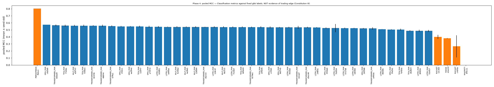
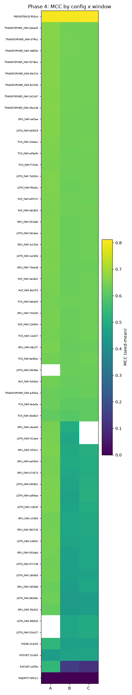
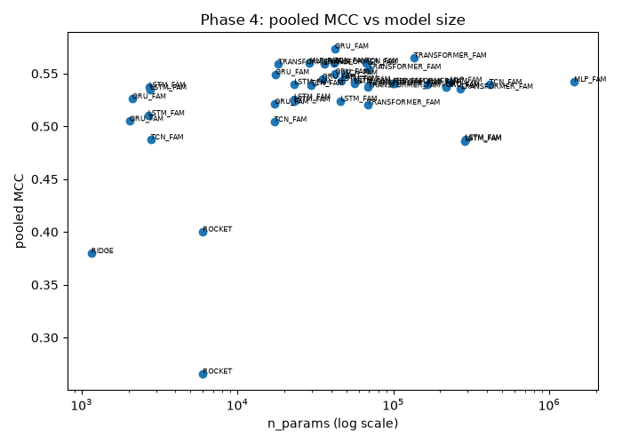
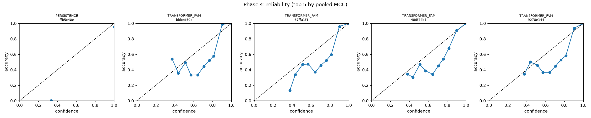

## 3. Gate decisions

### Phase 3 gate decision

# Gate decision: phase 3

Classification metrics against fixed gbb labels; NOT evidence of trading edge (Constitution III).

## Rule (FR-028)

- margin_floor = 0.02
- margin_used = 0.020
- std_bound = 0.03
- majority_of = 3
- std_mode = every

## RIDGE reference

| window | MCC (seed-mean) | macro-F1 (seed-mean) |
|---|---|---|
| A | 0.533 | 0.656 |
| B | 0.535 | 0.652 |
| C | 0.547 | 0.666 |

pooled_seed_std_mcc = 0.002

## Per-config

| config_id | arch | A | B | C | viable |
|---|---|---|---|---|---|
| 076666f04306 | CNN | fail | fail | fail | False |
| 0875fd5bd454 | LSTM_INJIT | PASS | fail | fail | False |
| 098ca2f95a2e | LSTM2 | PASS | PASS | PASS | True |
| 0b31c7bb9404 | Multihead | PASS | PASS | PASS | True |
| 12c3636e7110 | ROCKET | fail | fail | fail | False |
| 225a954527c8 | LSTM_NORESIZE | PASS | fail | fail | False |
| 3a4ddb6c4092 | LSTM_NOISY | PASS | fail | fail | False |
| 3cd40f90604c | LSTM_KAN | PASS | fail | fail | False |
| 3d09879bf74b | LSTM_D10 | PASS | fail | fail | False |
| 470786990c9e | LSTM_NOCONV | PASS | fail | fail | False |
| 48b806ceba9b | LSTM_K5 | PASS | fail | fail | False |
| 52292292ef8b | Wavenet | PASS | PASS | PASS | True |
| 558e2f29084d | LSTM_NORES | PASS | fail | fail | False |
| 59d72ed6d750 | LSTM_PONDER | PASS | fail | fail | False |
| 60f40876941b | MLP | PASS | PASS | PASS | True |
| 666675f56e77 | Mamba2 | PASS | PASS | PASS | True |
| 6f0c110ce13c | MAJORITY | fail | fail | fail | False |
| 8d1446f2a484 | LSTM_RAW | PASS | fail | fail | False |
| 9c5b1e952784 | Mamba | fail | fail | fail | False |
| c43f5e55fe61 | ROCKET | fail | fail | fail | False |
| cf6b6ccb530a | Transformer | PASS | PASS | PASS | True |
| d1dc0339b10b | RIDGE | fail | fail | fail | False |
| d2bbc0d7fb15 | LSTM | PASS | PASS | PASS | True |
| d7fcd89ef3d6 | LSTM_POOL | PASS | fail | fail | False |
| e645063be7bc | LSTM_W64 | PASS | fail | fail | False |
| ea8d90054291 | Attention | PASS | PASS | PASS | True |
| f1f70fadabbb | TSMamba | fail | PASS | PASS | True |
| f37089f602fe | GRU | PASS | PASS | PASS | True |
| ffb5c40e8d6b | PERSISTENCE | PASS | PASS | PASS | False |

## Viable set

- 098ca2f95a2e
- 0b31c7bb9404
- 52292292ef8b
- 60f40876941b
- 666675f56e77
- cf6b6ccb530a
- d2bbc0d7fb15
- ea8d90054291
- f1f70fadabbb
- f37089f602fe

## Stability-only failures (third-seed candidates)

| config_id | arch | failing windows |
|---|---|---|
| 225a954527c8 | LSTM_NORESIZE | B, C |

## Notes

- RIDGE/MAJORITY/PERSISTENCE/ROCKET are baselines: shown for reference, never in viable_set.
- margin_used = max(margin_floor, 2 x RIDGE's pooled across-seed MCC std); windows where RIDGE itself had <2 seeds are excluded from that pooled std (research R8/FR-028).
- A config with a missing, collapsed or failed window is never viable, regardless of its metrics on the other windows.
- std_mode=every: 'every' (spec FR-028(ii)) requires std_ok on EVERY window independent of the margin-majority vote; 'majority' folds std_ok into window_pass so instability can be outvoted (pre-fix behaviour, kept for comparison only).
- stability_only_failures lists configs that clear the margin on a majority of windows and have no bad status, but fail the stability bound on at least one window -- FR-004 allows these to receive a third seed before a final fail decision.

decided_at: 2026-09-19T14:30:44.891920+00:00
decided_by: gate.py + author review at checkpoint

## Author decision (2026-09-19 07:35): stop the B/C re-run after 11 of 23 types

With the learning-free trigger rule established as the ceiling and every completed type at
it (Transformer, LSTM, LSTM2, Multihead, GRU, Wavenet within 0.003 of each other; Mamba2, MLP
0.01 below; Attention, TSMamba, CNN structurally below), the window-B/C rows of the twelve
LSTM ablation variants were not re-run. Their clean window-A rows stand; their B/C rows are
retracted and reported as "not re-run — ceiling established". Mamba: A/B only.


#### Review memo: `review_3.md`

# Gate-3 review (T031): phase 2 baselines + phase 3 existing types

Classification metrics against fixed gbb labels (ind24, seq_len 16, windows A=2023-H2 / B=2025-H1 / C=2026-H1). Nothing here is evidence of trading edge (Constitution III). Source: `research/clfstudy/results/results.jsonl` (195 rows, git 303098b), `report/leaderboard_{2,3}.md`. Reviewer recomputed every number below from the raw rows (last line per key, as `leaderboard.load_results` does).

## 1. Sanity checks

Pass: MAJORITY bal-acc 0.333 / MCC 0.000 / macro-F1 0.310 on all 9 rows, logloss 0.41-0.48 (= class-prior entropy). PERSISTENCE MCC 0.801/0.802/0.812, prec = rec per class (one-hot by construction). Neural per-class profile is what a ~85%-HOLD label with inverse-frequency weights should give: HOLD prec 0.94-0.95 / rec 0.90; SELL prec ~0.50 / rec ~0.67; BUY prec ~0.54 / rec ~0.76 (minority recall > precision). Neural logloss 0.20, AUROC-macro 0.955, ECE 0.02-0.03. `epochs_run` max 40; no row exceeds. No leakage signal: every model sits well under the label-autocorrelation ceiling PERSISTENCE sets (0.805) and window-A results saturate at 0.66 across 13 unrelated architectures, which is a data ceiling, not a leak.

Non-ok rows: MAJORITY collapsed x9 (by construction). ROCKET pre-fix c43f5e55fe61: B/1 and B/2 `failed` (Metal GPU page fault, transient, retried) then `collapsed` (best_epoch 0, all-HOLD); C/1 and C/2 are status `ok` with MCC 0.005 / -0.028 and pred_counts [0,166286,24850] / [2,16500,174634]. No `class_absent` rows.

Instrument problems (not model properties):
- **Multihead 0b31c7bb9404 was run twice for 4 of 6 keys (A/1, B/0, B/1, C/0) by two concurrent `phase` processes** (overlapping started/finished stamps 22:20-22:40). The duplicate pairs have identical metrics to 6 dp but different best_epoch / epochs_run / train_seconds (e.g. A/1: 29/40/202 s vs 3/14/82 s), so the second process evaluated the first's checkpoint. Leaderboard metrics survive (last-line dedupe), but Multihead's timing/epoch columns are unreliable and its window-A seed gap (0.657 vs 0.516, sd 0.100) is plausibly checkpoint contamination. Needs a lock on resume and a clean 2-seed rerun of Multihead window A (~8 min) before it can be judged.
- **Collapse detector misses near-collapse**: the two pre-fix ROCKET C rows above (91-96% single-class, MCC ~0) are `ok`; B/2 with [2,173746,12] was `collapsed`. The status clause of FR-028 therefore only catches exact single-class output; the margin clause catches these in practice, but a "degenerate" flag at max-class-share > 0.9 or MCC < 0.05 would make the status clause honest.
- **buy_prec@0.8 is unresolvable for the top types**: pooled p_buy>=0.8 row counts over 6 runs are Transformer 352, LSTM_KAN 496, LSTM/NORES/NOCONV/NORESIZE 0 (NaN). Under focal loss + class weights the 0.8 production threshold sits in an empty tail; the column should not be used to rank anything. Only Mamba2 / GRU / CNN / TSMamba (~1% coverage, precision 0.60-0.68) and Mamba (10%, 0.36) have mass.
- ROCKET (fixed) is 3-17 min/run (9.4 mean, 11x RIDGE) and still seed-sensitive on A (0.356 / 0.506 / 0.487); it is not the "cheap" baseline R6 intended and at seq_len 16 has no multi-scale property (methods.md). Fine as a reference row; never the gate bar.

## 2. Baseline-vs-existing gap

RIDGE (d1dc0339b10b, 3 seeds): MCC A 0.533 +/- 0.003, B 0.307 +/- 0.004, C 0.299 +/- 0.003; macro-F1 0.656 / 0.517 / 0.508. Pooled seed-std (mean of per-window ddof=1 stds) = 0.0033. **margin_used = max(0.02, 2 x 0.0033) = 0.02.**
ROCKET fixed (12c3636e7110, 3 seeds): MCC 0.450 +/- 0.082 / 0.380 +/- 0.007 / 0.371 +/- 0.000; macro-F1 0.611 / 0.584 / 0.577. Below RIDGE on A, +0.07 on B/C; pooled 0.400 vs 0.380. Pre-fix c43f5e55fe61 (0.266 pooled, sd up to 0.25) is history only.

Margin clauses (MCC and macro-F1 both >= RIDGE + 0.02) on a majority of windows: **23 of 24 existing types pass** (Mamba passes 1 window only). TSMamba fails A (-0.031), CNN fails A on F1 (+0.012), both pass B and C. The gap is large: neural types beat RIDGE by 0.11-0.13 MCC on A and 0.18-0.23 on B/C.
Stability clause (seed-std MCC <= 0.03 on every window): **13 of 24 fail**, all on B or C, where the seed gap is 0.03-0.06 MCC. With 2 seeds std = |a-b|/sqrt(2), so the bound is |a-b| <= 0.042; the failing pairs trace to early stopping (one seed best_epoch 1, stops at 12; the other best_epoch 14). Plain LSTM (production) fails on C (0.042); LSTM_K5, identical to it within 0.000 pooled MCC, passes. The rule is reacting to loop noise, not architecture.
Rule-viable as written (10): Transformer, LSTM_K5, LSTM_KAN, LSTM_W64, GRU, LSTM2, MLP, Attention, TSMamba, CNN. Rule-failing on stability only (12): LSTM_NORES, Wavenet, LSTM_NOCONV, LSTM, LSTM_D10, LSTM_NORESIZE, LSTM_NOISY, LSTM_POOL, Mamba2, LSTM_RAW, LSTM_INJIT, LSTM_PONDER, Multihead. Failing margin too: Mamba.

## 3. Ranking observations

Top-5 pooled MCC (per-window A/B/C; params; wall min/run): Transformer 0.564 (0.664/0.503/0.526; 15.6k; 5.0), LSTM_NORES 0.564 (0.664/0.495/0.533; 12.5k; 4.1), Wavenet 0.561 (0.659/0.497/0.525; 16.2k; 3.6), LSTM_NOCONV 0.560 (0.663/0.488/0.528; 12.5k; 3.9), LSTM 0.558 (0.664/0.493/0.517; 12.5k; 3.9). Spread 0.006 pooled, inside the 0.02-0.04 seed std on B/C: **the top 13 (down to LSTM_W64 0.549) are one tie**. On window A every one of them lands at 0.662-0.665 with seed-std <= 0.002 - a hard ceiling for this input in that regime, independent of architecture.

Dominated (worse AND larger/slower than something above it): GRU (142.6k, 9.5 min, 0.540) and LSTM2 (86.8k, 7.9 min, 0.536) by LSTM; Attention (12.5k, 4.6, 0.505) by Transformer; Mamba2 (19.4k, 4.9, 0.541, sd 0.039 on C) by LSTM_K5; TSMamba (37.4k, 9.0, 0.479) by everything neural; Mamba (21.3k, **29.9 min**, 0.398, logloss 0.79, ECE 0.14, sd 0.08-0.13 on every window) by RIDGE on cost. MLP (136.5k, 2.2 min, 0.528) and CNN (2.2k, 1.5 min, 0.441) are dominated on metric but are the cheapest runs.

LSTM ablations vs plain LSTM (pooled 0.558). Window A is the only resolvable window (seed-std ~0.001); B/C noise is 0.03-0.06. Within noise everywhere: NORES +0.006, NOCONV +0.002, D10 0.000, NORESIZE 0.000, K5 0.000, NOISY -0.001, KAN -0.003 - i.e. the conv front-end, residual, resize projection, kernel width, dropout level, latent noise and KAN head are all inert. Resolvable harm: POOL(mean) -0.021 on A at sd 0.001 (last-timestep readout is the one structural piece that matters); INJIT -0.014 on A at sd 0.001, -0.03 on B/C; W64 -0.016 on B at sd 0.006 (doubling width does not help - consistent with GRU/LSTM2 at 7-11x params scoring lower). Unresolved: PONDER -0.052 on B at sd 0.039; RAW -0.042 on C at sd 0.076.

Regime: A (9 pairs, 418k train rows, test 4.0% SELL / 6.3% BUY) is easier for everyone (RIDGE 0.533, neural 0.66); B/C (10.5% / 7.4% BUY) harder (RIDGE 0.30, neural 0.49-0.53). The non-linear advantage over RIDGE is 0.13 on A and 0.19-0.23 on B/C. Ranking is stable across windows for the top tie; the only per-window instability is Multihead A (instrument, above) and ROCKET A.

Calibration: top types ECE 0.020-0.025 pooled (A ~0.05, B/C 0.003-0.012), logloss 0.20; RIDGE 0.094, ROCKET 0.048, Mamba 0.142. BUY precision/coverage at 0.8: see section 1 - empty tail for the top tie.

## 4. Cost

Measured: phase 3 = 148 rows, 836 wall-min = **13.9 h vs 8.8 h projected** (5.65 min/run; 4.62 ex-Mamba; calibration 3.68). Phase 2 = 2.6 h (fixed ROCKET alone 1.4 h). Spent ~16.5 h of 40. Per family (wall min/run): LSTM@32 3.9, LSTM ablations 4.2, LSTM2 7.9, GRU 9.5; CNN 1.5, Wavenet 3.6; Multihead 3.6, Attention 4.6, Transformer 5.0; Mamba2 4.9, TSMamba 9.0, Mamba 29.9; MLP 2.2.
Projection at R10 counts with these rates: phase 4 (186 runs: RNN 60 @ ~6 incl. hidden-256 rungs, TCN 42 @ ~3.5, Transformer 54 @ ~5.5, MLP 30 @ ~2.2) ~14.6 h; phase 5 (36 @ ~5) ~3.0 h; phase 6 (24 @ ~6; more if an SSM candidate) ~2.4 h; phase 7 (120 @ ~4.6) ~9.2 h. Phases 4-7 ~29 h; **total ~46 h - the 40 h budget does not hold.** Cuts in order: (1) `train.stride=2` on phases 4-6 (R10's listed second cut; the first, 1-seed LSTM ablations, is moot) ~-9 h -> ~37 h; (2) fold GRU_FAM into the RNN family with cell type as one structural run at the anchor (GRU is dominated) ~-2.5 h; (3) 1 seed on the largest size rung per family (hidden 256, d_model 128, channels 256, width 1024) ~-1.5 h; (4) phase-7 third seeds for the top 2 only.

## 5. Proposed viable set and phase-4 anchors

Rule as written: the 10 types in section 2. The rule is miscalibrated here in both directions: the margin clause discriminates nothing (23/24 pass) and the stability clause fails the production LSTM on a 2-seed early-stop artefact while passing its metrically identical siblings. Proposed amendment, within the spec's own "seeds raised for close calls" allowance: a config failing ONLY the stability clause, with margin clauses passed on all 3 windows, gets a third seed on the failing window before the decision; the bound is then applied to the 3-seed std.
Judgment on the finalist pool (existing types carried to phases 5-7):
- **Carry: Transformer** (co-top, stable on all windows, best calibrated, 15.6k params, 5.0 min). **LSTM** (production reference; tied for top; fails only C stability by 0.012 - third seed on C, ~5 min). **Wavenet** (only distinct conv structure in the top tie, cheapest of the three at 3.6 min; fails only C stability by 0.004 - third seed on C).
- **Drop, though rule-viable**: GRU, LSTM2 (dominated by LSTM on params, time and MCC); Attention (dominated by Transformer at equal params); TSMamba, CNN (0.48 / 0.44, below RIDGE on A or F1-marginal); MLP (0.528 at 136k, below the tie; MLP_FAM covers it in phase 4); LSTM_K5 / LSTM_KAN / LSTM_W64 (indistinguishable from LSTM - carrying them triples phase-7 cost for one architecture). Borderline: LSTM_NORES (0.564; same as LSTM within 0.006; the residual is inert, so carry LSTM, not both).
- **Drop**: Mamba (30 min/run, unstable, worst-calibrated neural type); Multihead (cannot be judged until the window-A rerun; even at its seed-0 A value it is <= Transformer).
Phase-4 anchors from what phase 3 shows: LSTM_FAM - the size axis {16,64,256} is predicted flat-to-negative (32 -> 64 -0.009; 87k/143k models lower), so depth=2 and bidirectional are the axes to watch, and a 16-hidden run may tie the anchor; keep last-timestep readout (mean pool costs 0.02 on A). TRANSFORMER_FAM - the existing 15.6k Transformer already sits on the ceiling; d_model 32 is likely to tie 64, so layers {1,4} and pos {none, rope} carry the information. TCN_FAM - CNN (2.2k) 0.44 vs Wavenet (16k) 0.56 says the conv family is the one where channels/dilation should move MCC beyond noise; this is the sweep most worth full seeds. MLP_FAM - expect a plateau near 0.53 independent of width; cheapest family, lowest expected information. GRU_FAM - see cut (2).
Note for phase 7: seed variance on B/C is a loop property (early stop at best_epoch 1); 3 seeds on finalists is the right instrument, not more architectures.


#### Review memo: `review_3_final.md`

# Gate-3 review, final (clean rows): phase 3 existing-type census

Classification metrics against fixed gbb labels (ind24, seq_len 16, windows A/B/C, production protocol lr 1e-4 / stride 1 / patience 10 / cap 40). Nothing here is evidence of trading edge (Constitution III). Sources: `results/results.jsonl` (phase-3 rows; clean = window A any date, B/C started >= 2026-09-18T07:00Z, last row per key: 95 rows, all `ok`), `gates/phase_3.json` (decided 2026-09-19 14:30Z), `report/methods.md` (ROOT CAUSE, trigger-rule ceiling, Mamba exclusion), `gates/review_4.md`. References: trigger rule A 0.673 / B 0.644 / C 0.642; clean RIDGE 0.533 / 0.535 / 0.547; fixed ROCKET 0.450 / 0.516 / 0.526; PERSISTENCE 0.80; MAJORITY 0. Supersedes `gates/review_3.md`.

## 1. What review_3.md got wrong

Every B/C row it read (seeds 0-1, phases 2-3) had been warm-started from the window-A checkpoint (methods.md ROOT CAUSE), including the RIDGE reference it quoted (0.307 / 0.299 on B/C; clean: 0.535 / 0.547). From that it inferred (a) B/C are a "harder regime" where neural types sit at 0.49-0.53 and beat RIDGE by 0.19-0.23; (b) 13 of 24 types fail the stability clause on B/C through early-stopping "loop noise", motivating a third-seed amendment; (c) dominance/drop calls on GRU, LSTM2, Mamba2, Multihead and the "TCN is the sweep most worth full seeds" anchor; (d) a cost projection built on those runs. All withdrawn. What survives: the window-A numbers (0.66 ceiling, LSTM_POOL -0.02, LSTM_INJIT -0.014, mean-pool readout matters), the MAJORITY/PERSISTENCE sanity checks, the empty-tail warning on buy_prec@0.8, and ROCKET's cost/seed-sensitivity note. The Multihead A gap it flagged was indeed contamination, but the clean re-run put Multihead at the ceiling, not below it.

## 2. Clean census (MCC mean +/- 2-seed std; pooled = mean over available windows; min/run = mean wall over clean rows)

| type | windows | pooled MCC / F1 | A | B | C | params | min/run |
|---|---|---|---|---|---|---|---|
| Transformer | ABC | 0.649 / 0.735 | 0.664 +/- .003 | 0.642 +/- .000 | 0.640 +/- .000 | 15,587 | 8.5 |
| LSTM (production) | ABC | 0.649 / 0.735 | 0.664 +/- .001 | 0.642 +/- .000 | 0.641 +/- .000 | 12,483 | 7.7 |
| LSTM2 | ABC | 0.649 / 0.735 | 0.663 +/- .000 | 0.643 +/- .000 | 0.640 +/- .000 | 86,787 | 14.3 |
| Multihead | ABC | 0.646 / 0.734 | 0.659 +/- .002 | 0.641 +/- .001 | 0.639 +/- .000 | 12,483 | 7.6 |
| GRU | ABC | 0.646 / 0.733 | 0.661 +/- .000 | 0.639 +/- .000 | 0.639 +/- .000 | 142,595 | 17.0 |
| Wavenet | ABC | 0.646 / 0.732 | 0.659 +/- .002 | 0.640 +/- .001 | 0.638 +/- .001 | 16,227 | 5.8 |
| Mamba2 | ABC | 0.640 / 0.729 | 0.644 +/- .011 | 0.639 +/- .001 | 0.638 +/- .001 | 19,407 | 10.5 |
| MLP | ABC | 0.640 / 0.727 | 0.653 +/- .001 | 0.634 +/- .002 | 0.633 +/- .002 | 136,515 | 3.8 |
| Attention | ABC | 0.612 / 0.706 | 0.618 +/- .005 | 0.601 +/- .001 | 0.618 +/- .001 | 12,483 | 6.5 |
| TSMamba | ABC | 0.592 / 0.707 | 0.502 +/- .004 | 0.638 +/- .002 | 0.636 +/- .002 | 37,435 | 15.3 |
| CNN | ABC | 0.549 / 0.663 | 0.555 +/- .004 | 0.537 +/- .004 | 0.555 +/- .003 | 2,211 | 2.6 |
| Mamba [A/B only] | AB | 0.492 / 0.601 | 0.513 +/- .079 | 0.470 +/- .019 | excluded (48 GB, 68 min) | 21,315 | 49.7 |
| LSTM_KAN [A + B seed 0] | A(B) | 0.663 / 0.743 (A) | 0.663 +/- .002 | 0.643 (n=1) | not run | 11,907 | 3.5 (A) |
| LSTM_PONDER [A only] | A | 0.665 / 0.745 | 0.665 +/- .001 | - | - | 14,659 | 4.2 |
| LSTM_NOISY / NORES [A only] | A | 0.664 / 0.744 | 0.664 +/- .000 | - | - | 12,483 | 3.6 |
| LSTM_D10 / NORESIZE / NOCONV [A only] | A | 0.663 / 0.743 | 0.663 +/- .000 | - | - | 12,483 / 10,539 / 12,483 | 3.6 |
| LSTM_K5 / W64 [A only] | A | 0.662 / 0.742 | 0.662 +/- .001 | - | - | 15,555 / 47,491 | 3.5 / 4.2 |
| LSTM_RAW [A only] | A | 0.661 / 0.741 | 0.661 +/- .001 | - | - | 10,539 | 3.5 |
| LSTM_INJIT [A only] | A | 0.650 / 0.739 | 0.650 +/- .001 | - | - | 12,483 | 3.6 |
| LSTM_POOL [A only] | A | 0.643 / 0.727 | 0.643 +/- .001 | - | - | 12,483 | 3.6 |

Sanity: no leakage (all < PERSISTENCE 0.80), no collapse (ceiling types predict ~11 / 73 / 16 % SELL/HOLD/BUY, BUY recall 1.0), every 2-seed std <= 0.011 except Mamba A (0.079). Per-window ranking among the top six is a tie: spread 0.005 on A, 0.004 on B, 0.003 on C, at seed std 0.000-0.003 - the order changes window to window and means nothing. B/C rows are 2-3x the wall time of A (larger windows); min/run above is the pooled mean, A-only entries are cheaper by construction. Thirteen pre-cutoff single-seed B/C rows (the 2026-09-17 seed-2 third seeds) remain in `leaderboard_3` / `phase_3.json` but are excluded here; 12 of 13 sit at 0.637-0.641 (agree with the ceiling), the 13th is LSTM_NORESIZE C/2 = 0.504 with best_epoch 6 - a from-scratch stall under the production protocol that the ceiling story does not explain and that the stop decision leaves untested.

## 3. Position against the trigger-rule ceiling (gap = type - rule, A / B / C)

- **At the ceiling (within 0.01 on every window):** Transformer -0.009 / -0.002 / -0.002; LSTM -0.009 / -0.002 / -0.001; LSTM2 -0.010 / -0.001 / -0.002. On A only (no clean B/C): PONDER, NOISY, NORES, D10, NORESIZE, NOCONV, KAN (-0.008 to -0.010).
- **Within 0.01 on B/C, 0.012-0.015 under on A:** Multihead -0.014 / -0.003 / -0.003; GRU -0.012 / -0.005 / -0.003; Wavenet -0.014 / -0.004 / -0.004; A-only K5, W64, RAW (-0.011 to -0.012). Everyone's A gap is ~0.005 wider than their B/C gap, so a strict 0.01-on-every-window rule splits this group from the first on A alone, by 0.003-0.005 at seed std 0.002 - real but immaterial; I treat both groups as ceiling-bound.
- **0.01-0.03 below:** Mamba2 -0.029 / -0.005 / -0.004 (A seed spread 0.011, one seed at the ceiling); MLP -0.020 / -0.010 / -0.009 (flattened 16x24 input, no last-bar readout); LSTM_INJIT -0.023 (A); LSTM_POOL -0.030 (A; mean-pool readout).
- **Structurally below** (hypotheses from the model code in `NNNC/NNNClassifierMLX.py`, not tested):
  - Attention -0.055 / -0.043 / -0.024 (12.5k params, same front-end as Multihead). `_AttentionModel` is one attention block with NO positional embedding, K/V projected from the raw input (bypassing the conv), post-LN, global average pool. Without position the block is permutation-invariant over the 16 bars and the mean pool cannot isolate the last bar, where the trigger (guard_metric, bb_width) is evaluated; `_MultiheadModel` adds `TransformerPositionalEmbeddingMLX` and self-attends on the conv output and reaches the ceiling. Phase 4's `pos=none` cost (-0.036 / -0.022 / -0.014, review_4 s.2) is the same effect at smaller size.
  - TSMamba -0.171 on A, but -0.007 / -0.006 on B/C (at the ceiling). Both A seeds stop at epochs 15-16 with best_epoch 4-5 at MCC 0.50 = RIDGE level (the linear half of the rule); on B/C best epochs 13-22. `_TSMambaModel` = bidirectional Mamba2 x 2 layers, averaged and mean-pooled, KAN head, RMSNorm. Hypothesis: an optimisation stall on the A distribution (4.0 / 6.3 % signal share) that patience 10 turns into an early stop, i.e. a protocol x architecture interaction, not a capacity limit; a patience-40 or lr 3e-4 re-run on A (2 x ~5 min) would settle it. Same signature as LSTM_NORESIZE C/2.
  - CNN -0.118 / -0.107 / -0.087 (2.2k params). `_CNNModel` = one causal conv, kernel 2 (receptive field 2 bars), tanh, BN, global average pool, 16-unit head. Receptive field 2 with no dilation and a mean pool that dilutes the last bar 1/16: it can only fit the linear approximation of the AND (RIDGE + 0.01). Phase 4's starvation axis (TCN ch16 or RF <= 5 costs 0.02-0.03; review_4 s.2) is the same effect; CNN is its extreme.
  - Mamba -0.160 / -0.174 (A / B), seed std 0.079 on A, logloss 0.81, ECE 0.16: never converges to the rule; excluded on C (methods.md 2026-09-19 05:15).

## 4. FR-028 as written (`gates/phase_3.json`: margin_used 0.020 = floor, RIDGE pooled seed std 0.002; std_bound 0.03 on every window; majority of 3; no failed/collapsed window)

- **Viable (10):** LSTM2, Multihead, Wavenet, MLP, Mamba2, Transformer, LSTM, Attention, TSMamba, GRU. Margins over RIDGE + 0.02: ceiling types clear by +0.07 to +0.11 MCC and +0.04 to +0.07 macro-F1 on every window; Attention by +0.05 / +0.05 / +0.05; TSMamba fails A (-0.051 below the bar) and passes on the B/C majority.
- **Fail (2 + 12):** CNN (A: MCC +0.001 over the bar but macro-F1 0.668 < 0.676; B/C fail both); Mamba (margin on both windows, std on A). The twelve LSTM ablations fail on `missing_window` (B/C retracted, not re-run) - an administrative fail, not a metric one; their A rows all pass the margin. LSTM_NORESIZE's "stability-only failure" in the JSON is a single-seed NaN-std artefact from the pre-cutoff rows, not instability.
- **Stability:** every clean 2-seed std is <= 0.011; 0 real stability failures. The third-seed amendment proposed in review_3.md is moot.
- **Non-discrimination:** the rule passes Transformer (0.664 / 0.642 / 0.640) and Attention (0.618 / 0.601 / 0.618) with the same verdict, and passes TSMamba although it sits at RIDGE level on one window. It is correct as a viability screen (everything neural except CNN/Mamba is >= 0.05 over RIDGE + margin) and has no resolution among ceiling-bound types (spread 0.005) - same conclusion as review_4 s.4. Amendment (record, do not bend): keep FR-028; add a "ceiling-bound" tag (within 0.01 of the trigger rule on B/C) and use the trigger-conditional metrics of s.5 as the selection metric.

## 5. Trigger-conditional metrics (phase-3 rows started after 2026-09-19 03:00Z: 42 rows, B/C only; `trig_rule_mcc` reproduces the rule at B 0.645 / C 0.642)

| type | BUY AUROC within trigger, B / C | argmax BUY precision lift, B / C | trig_buy_mcc B / C |
|---|---|---|---|
| Transformer | 0.590 / 0.623 | +0.000 / +0.000 | 0.01 / 0.01 |
| LSTM | 0.591 / 0.623 | +0.001 / +0.001 | 0.01 / 0.02 |
| LSTM2 | 0.588 / 0.623 | +0.000 / +0.000 | 0.01 / 0.01 |
| GRU / Wavenet / Mamba2 | 0.585 / 0.612, 0.584 / 0.614, 0.578 / 0.612 | +0.001 / +0.001 | 0.02 / 0.02 |
| MLP | 0.588 / 0.631 | +0.001 / +0.001 | 0.03 / 0.02 |
| Attention / TSMamba | 0.578 / 0.607, 0.561 / 0.599 | +0.000-0.003 | 0.00-0.03 |
| CNN | 0.571 / 0.588 | +0.013 / +0.017 | 0.07 / 0.09 |
| Mamba (B) | 0.551 | +0.002 | 0.02 |

Base rates 0.507 (B, n 35,867) / 0.454 (C, n 31,349). Reading: identical to phase 4 (review_4 s.5: B 0.566-0.592, C 0.600-0.626). Every ceiling-bound type orders triggered bars a little better than chance (AUROC ~0.59 B / ~0.62 C, seed std <= 0.008) and its argmax calls every triggered bar BUY (lift <= 0.001). Between-type AUROC differences are 0.01-0.02 on C at seed std up to 0.007: MLP's 0.631 is the highest single figure in either phase but not resolvable from Transformer/LSTM's 0.623. CNN's larger lift and trig_buy_mcc come from NOT reproducing the trigger (it withholds BUY on some triggered bars), not from more information - its AUROC is the lowest of the neural types. SELL side: AUROC 0.53-0.58, lift <= 0.006, for all types. Multihead and Mamba2 B/1 predate the instrument and carry no trig fields. Precision at reduced coverage (top-k by p_buy within the trigger) is still unmeasured - the only number that would show information beyond the trigger.

## 6. Gate-3 decision as it now stands

- **Finalist pool of existing types for any later work:** production **LSTM** (12,483 params; the deployment reference), **Multihead** (12,483; cheapest attention type), **Wavenet** (16,227; only conv type at the ceiling, cheapest per run at 5.8 min), **Transformer** (15,587; best pooled figure, +0.000 over LSTM). All four are within 0.003 of each other on B/C and within 0.005 on A, so the choice among them is cost, not metric; LSTM2 / GRU tie on metric at 7-11x the parameters and 2x the wall time and are dropped on cost. Mamba2 and MLP are 0.01-0.03 under and add nothing the four do not; Attention, TSMamba, CNN, Mamba are below the ceiling for the reasons in s.3.
- **Retracted from the earlier decision:** the third-seed amendment (moot - no clean stability failure exists); the 13 "stability-only" failures (warm-start artefacts); the "B/C regime is harder for neural types" reading (B/C are 0.03 harder for the RULE itself, 0.673 -> 0.644, and every type tracks it); the GRU/LSTM2 "dominated" calls now rest on cost only; the TCN-as-informative-sweep anchor (phase 4 showed the conv family reproduces Wavenet once the grid point is sane).
- **Standing conclusions consistent with review_4:** the architecture question is closed - every type that trains from scratch reaches the trigger rule and none exceeds it on any window; the only unmeasured quantity is within-trigger precision at reduced coverage, and phase 7 (inputs) is the only phase that can move it.
- **Not done, by author decision (recorded, not disputed):** clean B/C for the 12 LSTM ablations; Mamba on C; the TSMamba-on-A and LSTM_NORESIZE-C/2 stall diagnoses. None of these can change the finalist pool; the two stalls are the only loose thread in the "everything converges from scratch" claim.

Open question: does the author want the "ceiling-bound" tag and the trig-conditional selection metric written into `gates/phase_3.md` as an amendment, or left as a reviewer note here (review_4 Q1 asks the same for phase 4)?


### Phase 4 gate decision

# Gate decision: phase 4

Classification metrics against fixed gbb labels; NOT evidence of trading edge (Constitution III).

## Rule (FR-028)

- margin_floor = 0.02
- margin_used = 0.020
- std_bound = 0.03
- majority_of = 3
- std_mode = every
- ridge_phase = 2

## RIDGE reference

| window | MCC (seed-mean) | macro-F1 (seed-mean) |
|---|---|---|
| A | 0.533 | 0.656 |
| B | 0.537 | 0.654 |
| C | 0.547 | 0.666 |

pooled_seed_std_mcc = 0.003

## Per-config

| config_id | arch | A | B | C | viable |
|---|---|---|---|---|---|
| 053da6234557 | GRU_FAM | PASS | fail | fail | False |
| 0727d8e81d1b | LSTM_FAM | PASS | fail | fail | False |
| 1260944a8d42 | MLP_FAM | PASS | PASS | PASS | True |
| 128c3f1c31d8 | LSTM_FAM | PASS | fail | fail | False |
| 12af479dfaa3 | TCN_FAM | PASS | PASS | PASS | True |
| 12c3636e7110 | ROCKET | fail | fail | fail | False |
| 1804839ab883 | LSTM_FAM | PASS | fail | fail | False |
| 1f2b114246b7 | GRU_FAM | PASS | fail | fail | False |
| 248fd1539819 | LSTM_FAM | PASS | fail | fail | False |
| 265588001083 | GRU_FAM | PASS | fail | fail | False |
| 318ea175aa05 | TCN_FAM | PASS | PASS | PASS | True |
| 3413d77700b0 | TRANSFORMER_FAM | PASS | PASS | PASS | True |
| 3c120e544d4e | GRU_FAM | PASS | PASS | PASS | True |
| 486f44b1f862 | TRANSFORMER_FAM | PASS | PASS | PASS | True |
| 4a28d1ce4ebd | MLP_FAM | PASS | PASS | PASS | True |
| 4c265676afae | LSTM_FAM | PASS | PASS | PASS | True |
| 51b427ea03a3 | LSTM_FAM | fail | fail | fail | False |
| 551b8bb6dcf2 | GRU_FAM | PASS | PASS | PASS | True |
| 5616ab5d0bd0 | LSTM_FAM | PASS | PASS | PASS | True |
| 5fa2b2e33ecb | GRU_FAM | PASS | fail | fail | False |
| 67ffa1f12fbd | TRANSFORMER_FAM | PASS | PASS | PASS | True |
| 68c1f710246f | GRU_FAM | PASS | PASS | PASS | True |
| 6f0c110ce13c | MAJORITY | fail | fail | fail | False |
| 6fe7246246f5 | TRANSFORMER_FAM | PASS | PASS | PASS | True |
| 702b00fcb20c | GRU_FAM | PASS | PASS | PASS | True |
| 70eb48f9acfb | GRU_FAM | PASS | PASS | PASS | True |
| 7b50342154ef | LSTM_FAM | PASS | PASS | PASS | True |
| 821f46c115ab | TRANSFORMER_FAM | PASS | PASS | PASS | True |
| 88268c05998b | LSTM_FAM | PASS | fail | fail | False |
| 8a9bbc798cf3 | TCN_FAM | PASS | PASS | PASS | True |
| 8e1f1550ad56 | MLP_FAM | PASS | PASS | PASS | True |
| 8f8526a69864 | LSTM_FAM | fail | fail | fail | False |
| 9278e1441b47 | TRANSFORMER_FAM | PASS | PASS | PASS | True |
| 9637450c6593 | GRU_FAM | PASS | fail | fail | False |
| 9c94bdef2a2d | MLP_FAM | PASS | PASS | PASS | True |
| a09a0b24d6fe | TCN_FAM | PASS | PASS | PASS | True |
| a4fb5eb48337 | TRANSFORMER_FAM | PASS | PASS | PASS | True |
| a7457da86656 | GRU_FAM | PASS | fail | fail | False |
| b558515c6d2c | LSTM_FAM | PASS | fail | fail | False |
| b5b58a6c2cc5 | LSTM_FAM | fail | PASS | PASS | False |
| b690297cbbf5 | LSTM_FAM | PASS | PASS | PASS | True |
| b8285305a779 | MLP_FAM | PASS | PASS | PASS | True |
| b85e94f80dc6 | TCN_FAM | PASS | PASS | PASS | True |
| bbbed50c3b5c | TRANSFORMER_FAM | PASS | PASS | PASS | True |
| c1f46501f6a0 | GRU_FAM | PASS | fail | fail | False |
| c43f5e55fe61 | ROCKET | fail | fail | fail | False |
| c6a3d0fd6d2d | GRU_FAM | PASS | fail | fail | False |
| cef2eef58d6b | GRU_FAM | PASS | PASS | PASS | True |
| d1dc0339b10b | RIDGE | fail | fail | fail | False |
| d5a1481bd4c0 | TRANSFORMER_FAM | PASS | PASS | PASS | True |
| dbd824e7736c | TCN_FAM | PASS | PASS | PASS | True |
| e5974774aa5f | MLP_FAM | PASS | PASS | PASS | True |
| ea594d5a1a9e | GRU_FAM | PASS | fail | fail | False |
| ed95eafb5053 | LSTM_FAM | PASS | fail | fail | False |
| f12de4f7b017 | LSTM_FAM | PASS | fail | PASS | True |
| f5be6cc3a0df | LSTM_FAM | PASS | PASS | PASS | True |
| f7d18cb3a30f | TCN_FAM | PASS | PASS | PASS | True |
| fa4e5ad070f7 | TCN_FAM | PASS | PASS | PASS | True |
| ffb5c40e8d6b | PERSISTENCE | PASS | PASS | PASS | False |

## Viable set

- 1260944a8d42
- 12af479dfaa3
- 318ea175aa05
- 3413d77700b0
- 3c120e544d4e
- 486f44b1f862
- 4a28d1ce4ebd
- 4c265676afae
- 551b8bb6dcf2
- 5616ab5d0bd0
- 67ffa1f12fbd
- 68c1f710246f
- 6fe7246246f5
- 702b00fcb20c
- 70eb48f9acfb
- 7b50342154ef
- 821f46c115ab
- 8a9bbc798cf3
- 8e1f1550ad56
- 9278e1441b47
- 9c94bdef2a2d
- a09a0b24d6fe
- a4fb5eb48337
- b690297cbbf5
- b8285305a779
- b85e94f80dc6
- bbbed50c3b5c
- cef2eef58d6b
- d5a1481bd4c0
- dbd824e7736c
- e5974774aa5f
- f12de4f7b017
- f5be6cc3a0df
- f7d18cb3a30f
- fa4e5ad070f7

## Stability-only failures (third-seed candidates)

_none_

## Notes

- RIDGE/MAJORITY/PERSISTENCE/ROCKET are baselines: shown for reference, never in viable_set.
- margin_used = max(margin_floor, 2 x RIDGE's pooled across-seed MCC std); windows where RIDGE itself had <2 seeds are excluded from that pooled std (research R8/FR-028).
- A config with a missing, collapsed or failed window is never viable, regardless of its metrics on the other windows.
- std_mode=every: 'every' (spec FR-028(ii)) requires std_ok on EVERY window independent of the margin-majority vote; 'majority' folds std_ok into window_pass so instability can be outvoted (pre-fix behaviour, kept for comparison only).
- stability_only_failures lists configs that clear the margin on a majority of windows and have no bad status, but fail the stability bound on at least one window -- FR-004 allows these to receive a third seed before a final fail decision.

decided_at: 2026-09-19T15:28:18.544913+00:00
decided_by: gate.py + author review at checkpoint


#### Review memo: `review_4.md`

# Gate-4 review: phase 4 single-family sweeps (clean rows; lr 3e-4, stride 2)

Classification metrics against fixed gbb labels (ind24, seq_len 16, windows A/B/C, 2 seeds). Nothing here is evidence of trading edge (Constitution III). Sources: `results.jsonl` (last row per key; 35 configs of `configs/phase_4.yaml`), `gates/phase_4.json` (decided 2026-09-19 04:18 UTC, margin 0.020, RIDGE A 0.533 / B 0.535 / C 0.547), `report/methods.md` ("ROOT CAUSE", "The ceiling is the label's trigger rule"). Trigger-rule ceiling (learning-free, BUY/SELL if guard_metric on the right side of 0.3 and bb_width > 0.035): A 0.673 / B 0.644 / C 0.642.

**Retraction of `review_4_interim.md`.** Its B/C claims rested on rows warm-started from the window-A checkpoint (methods.md ROOT CAUSE): the "B/C plateau at 0.42-0.55", "only recurrent cells reach 0.64", the TCN receptive-field axis, the MLP width inversion, the stall counts, and the phase-5 hypotheses about B/C convergence are all withdrawn. What survives: Transformer size is flat and `pos=none` costs MCC; LSTM_FAM hidden 256 diverges on A.

## 1. Sanity

- Rows: 35 configs x 3 windows x 2 seeds = 210 keys; 208 `ok`, 2 `failed`. Every config has n_seeds = 2 on every window (LSTM_FAM h64 window-C seed 0 is the clean C-only ablation row of 01:16 UTC, 0.633; seed 1 re-run 0.635). Stale ids from the input-norm era (19 LSTM/GRU ids, e.g. `f12de4f7b017`) appear in the gate table as history and are ignored here.
- Failures: LSTM_FAM hidden 256 diverged on window A 2/2 under `input_norm: false` (non-finite probabilities at epochs 23/30, best 12/19) and 2/2 under the earlier default -> 4/4. Recorded as a result: diverges under the shared protocol on A; B/C fine (0.631 / 0.630).
- Stalls (best_epoch <= 6): 0 of 208. Min best_epoch A 7, B 18, C 14; runs hitting the 40-epoch cap: A 31, B 48, C 51 of ~70 per window. B/C now converge more often than A.
- Seed std (2 seeds): rms A 0.0024 / B 0.0015 / C 0.0013; max 0.010 (Transformer pos=none, A), everything else <= 0.0044. Between-config gaps inside a family are mostly < 0.01, i.e. most rungs are separated by less than 2x seed std.
- No leakage (everything below PERSISTENCE 0.80, which uses the true previous label) and no collapse: ceiling-bound configs predict ~11% SELL / 72% HOLD / 17% BUY against true shares ~4 / 90 / 6 (BUY recall 1.0, precision ~0.5 = the trigger rule's confusion).

## 2. Per family: which axis moves MCC (delta vs anchor, A/B/C; resolvable = beyond ~0.005 and same sign on all three windows)

- **TCN_FAM** anchor ch64/k3/d3 (RF 7): 0.650 / 0.634 / 0.637, 29.6k params, 1.8 min. ch16 -0.034/-0.032/-0.024 (resolvable); depth 2 (RF 5) -0.024/-0.024/-0.022 (resolvable); ch32 -0.011/-0.008/-0.004 (A only); ch256 -0.008/-0.003/-0.004, kernel 5 -0.009/-0.003/-0.004, depth 6 +0.005/0.000/+0.001, dil2/depth4 -0.002/+0.002/0.000 (all noise). Only starvation (16 channels or RF <= 5) moves it; nothing beats the anchor.
- **TRANSFORMER_FAM** anchor d64/h4/L2/ffn2/learned: 0.664 / 0.641 / 0.638, 69k, 6.3 min. pos=none -0.036/-0.022/-0.014 (resolvable, consistent); rope -0.004/-0.001/0.000; d32 -0.002/0.000/+0.001; d128 -0.003/-0.002/-0.002; L1 -0.002/-0.001/+0.001; L4 0.000/-0.001/+0.001; heads 8 -0.002/-0.001/+0.002; ffn4 -0.001/-0.001/+0.001. Size is flat from 18k to 270k params.
- **MLP_FAM** anchor w256/d2: 0.646 / 0.629 / 0.634, 165k, 1.1 min. w64 +0.005/+0.004/0.000 and w128 +0.003/+0.004/+0.001 (at 2x std, not on C); w1024 -0.007/-0.006/-0.006 (consistent sign, ~2x std); depth 1/3 within 0.002. Nothing decisive.
- **LSTM_FAM** anchor h64: 0.654 / 0.632 / 0.634, 23k, 3.0 min. depth 2 +0.003/+0.005/+0.003 (same sign everywhere, only B clears 2x std); h16 -0.002/-0.002/-0.002; h32 -0.004/-0.002/-0.002; bidir +0.001/-0.001/-0.001; h256 diverged on A.
- **GRU_FAM** anchor h64: 0.651 / 0.628 / 0.630, 17.5k, 3.1 min. depth 2 +0.007/+0.010/+0.007 (resolvable on all three windows; the largest reproducible effect in the phase, still <= 0.01); h32 0.000/+0.003/+0.004; h16 -0.005/0.000/+0.002; h256 -0.004/-0.003/-0.003; bidir +0.001/+0.001/+0.002.

Summary: across 35 configs the only effects above seed noise are removals (pos=none, TCN RF <= 5 or 16 channels) and RNN depth 2 (+0.003 to +0.010). Nothing lifts any family above its anchor by more than 0.01.

## 3. Cross-family vs the trigger-rule ceiling (MCC A / B / C; gap to ceiling 0.673 / 0.644 / 0.642)

| family | best rung | A / B / C | gap A / B / C | params | min/run | cheapest rung within 0.01 of the ceiling on B/C |
|---|---|---|---|---|---|---|
| TRANSFORMER_FAM | d64 anchor (= L4, d32, h8, ffn4) | 0.664 / 0.641 / 0.638 | -0.009 / -0.003 / -0.004 | 69k | 6.3 | d64/L1: 0.662 / 0.640 / 0.639, 36k, 3.0 min (d32: 18k but 5.8 min) |
| GRU_FAM | depth 2 | 0.659 / 0.637 / 0.637 | -0.015 / -0.007 / -0.005 | 42k | 6.1 | h32: 0.651 / 0.631 / 0.634, 5.7k, 3.4 min |
| LSTM_FAM | depth 2 | 0.657 / 0.638 / 0.637 | -0.016 / -0.006 / -0.005 | 56k | 5.8 | h16: 0.653 / 0.630 / 0.633, 2.7k, 2.8 min |
| TCN_FAM | depth 6 | 0.656 / 0.635 / 0.638 | -0.017 / -0.009 / -0.004 | 67k | 2.6 | ch64/k3/d3: 0.650 / 0.634 / 0.637, 29.6k, 1.8 min |
| MLP_FAM | w128 | 0.649 / 0.633 / 0.635 | -0.024 / -0.011 / -0.007 | 66k | 1.05 | w64: 0.651 / 0.632 / 0.633, 29k, 1.0 min |

Every family converges to the trigger-rule ceiling and none exceeds it on any window: best rungs sit 0.003-0.011 under it on B/C and 0.009-0.024 under it on A. The whole cross-family spread (0.013 on A, 0.008 on B/C) is of the same order as the gap to the rule itself. The families rank Transformer > RNN depth 2 > TCN ~ MLP, and that order is stable across windows and above 2-seed std, but it is a ranking of how exactly each family reproduces an AND of two thresholds on the last bar, not of predictive content. The RIDGE reference (0.533 / 0.535 / 0.547) is the linear approximation of the same rule; phase-2 ROCKET (0.516 / 0.526 / 0.45) is below it.

## 4. FR-028 gate as written (`gates/phase_4.json`)

- Rule: margin_used 0.020 (floor; RIDGE pooled seed std 0.002 after quarantining the warm-started seed-2 B/C RIDGE rows), std_bound 0.03 on every window, majority of 3, no failed/collapsed window.
- Result: 34 of the 35 phase-4 configs viable; 0 stability-only failures. The one fail is LSTM_FAM h256 (`b5b58a6c2cc5`, failed on A). Margins are +0.08 to +0.13 MCC and +0.05 to +0.09 macro-F1 on every window; the smallest is TCN ch16 (A +0.083 / +0.054). The gate's viable list has 35 entries because it also passes `f12de4f7b017` (LSTM_FAM h64, superseded input-norm id) — stale history, not a phase-4 config.
- What the rule cannot do: it passes TCN ch16 (0.616 / 0.603 / 0.613) and Transformer d64 (0.664 / 0.641 / 0.638) with the same verdict, because every neural config is 0.07-0.13 over RIDGE and 0.00-0.05 under the trigger rule. As a viability screen it is correct; as a selector among ceiling-bound configs it has no resolution. Proposed amendment (record, do not bend the margin): keep FR-028 for viability and add, as an author decision in `phase_4.md`, (i) a "ceiling-bound" tag for any rung within 0.01 of the trigger rule on B/C, and (ii) the trigger-conditional metrics of section 5 as the metrics phases 5-7 are judged on; whole-window MCC stays reported but is no longer the gate metric once every candidate is ceiling-bound.

## 5. Trigger-conditional metrics (rows written after ~03:00 UTC 2026-09-19)

- Coverage: 23 phase-4 rows carry `trig_*` (MLP_FAM 5 configs x B/C x 2 seeds = 20; Transformer rope 3), all on B/C, none on A; plus 3 phase-0 smoke rows (ignored). `trig_rule_mcc` reproduces the learning-free rule exactly (B 0.645, C 0.642).
- Instrument anomaly: Transformer rope B seed 1 (`3413d77700b0`, 03:14 UTC, first row under sha 52fddd9) records trig_buy_n 714 and trig_rule_mcc 0.376 on the same 173,760-row test set where every later B row has trig_buy_n 35,867 / 0.645 (trig_sell_n 23,746 matches). Exclude that row; the 3 Transformer rows say nothing about the family yet.
- Within the BUY trigger (n 35,867 on B, 31,349 on C; base rate 0.507 / 0.454): argmax precision lift over the base rate is +0.001 to +0.008 on every row (max MLP w1024 on C, 0.462 vs 0.454); 0 of 22 rows reach +0.02. trig_buy_mcc 0.02-0.07. BUY-class AUROC within the trigger: 0.566-0.592 on B and 0.600-0.626 on C (MLP), 21 of 22 clean rows > 0.55, seed-to-seed agreement ~0.01, no monotone size trend (w1024 has the highest trig_buy_mcc and the lowest AUROC). SELL side: AUROC 0.53-0.57, precision lift <= +0.003.
- Reading: the models' BUY probability orders triggered bars a little better than chance (AUROC ~0.6 on C, reproducible across 5 MLP configs and both seeds) but the argmax decision never uses it — every triggered bar is called BUY (recall 1.0, precision = base rate). Whether AUROC 0.6 converts into precision at reduced coverage (e.g. the top 20% of triggered bars by p_buy) is unmeasured; that number, not MCC, is the one that would show information beyond the trigger.

## 6. Options for phases 5-7 given the ceiling

Architecture is closed: five families, 35 configs, 2.7k-1.4M params, all within 0.01 of a two-threshold rule on B/C. Whole-window MCC/macro-F1 cannot produce information from here, so each remaining phase is worth running only if judged on trigger-conditional metrics.

- **Phase 5 (compositions).** 5a: skip; record "considered, not run: every component is ceiling-bound and no composition can exceed a rule its components already reproduce" (0 h; FR-030 is satisfied vacuously, FR-027 still needs the recorded gate). 5b: run the two cheapest compositions (CNN_TRANSFORMER on d64/L1, RNN_ATTNPOOL on GRU h32), B/C only, with `trig_*` as the primary readout; ~1 h; informative only if within-trigger BUY AUROC or precision@coverage moves >= 0.03 vs the component. 5c: full grid as spec'd (~2.5 h at 3-6 min/run); expected null on MCC, the trig readout is the only possible signal.
- **Phase 6 (literature).** Same logic. The FR-031 obligations (citations, applicability, rank, "considered, not tested" reasons) are met by the review without runs. If run: TSMIXER / ITRANSFORMER / XLSTM / TRANSFORMER_MODERN at d32-equivalent sizes, B/C, trig readout, ~2 h. Expected: MCC 0.64, trig AUROC unknown — that is the one thing worth learning.
- **Phase 7 (inputs) — where the information is.** Measure, per row: (i) within-trigger BUY AUROC and precision at a fixed coverage (fix the coverage before running, e.g. top 20% of triggered bars) against the trigger base rate; (ii) whole-window MCC as secondary. Arms: raw8 vs ind24 vs both32 — raw8 cannot see guard_metric/bb_width, so its whole-window MCC will fall to RIDGE level or below and only the trigger-conditional view is a fair comparison; `ind24-minus:guards` and `-minus:volatility` answer R11's "does the model need to see the trigger" directly; seq_len 16/32/64/128 answers whether more history moves within-trigger AUROC (window length was never tested at the ceiling). Cost: MLP w64 (1.0 min) and TCN ch64 (1.8 min) make the ~102-run grid 2-3 h per representative; Transformer d64/L1 (3.0 min) ~5 h; an RNN h16/h32 ~5 h.
- **Families and representatives to carry.** All five pass FR-028. Cheapest ceiling-reaching representatives: MLP_FAM w64 (29k, 1.0 min), TCN_FAM ch64/k3/d3 (29.6k, 1.8 min), TRANSFORMER_FAM d64/L1 (36k, 3.0 min, keep `pos=learned`), GRU_FAM h32 (5.7k, 3.4 min) or LSTM_FAM h16 (2.7k, 2.8 min). Best-metric references if one is wanted: Transformer d64 anchor, GRU h64 depth 2. Drop from further sweeps: any size axis (flat everywhere), bidirectional (inert), TCN kernel/dilation (inert), h256 (diverges or is worse), MLP w1024 (worse, 1.4M params). For phase 7 three representatives (MLP w64, TCN ch64, Transformer L1) cover distinct inductive biases at ~10 h total; adding an RNN is another ~5 h for a family that behaves like the others.

## 7. Open questions

1. Amend FR-028 formally (ceiling-bound tag + trigger-conditional gate metrics) or keep it as written and record the selection rule for phases 5-7 as an author decision in `gates/phase_4.md`?
2. `trig_*` is computed only at training time and rows do not save probabilities (`weights_path` null), so the 187 phase-4 rows without it cannot be filled in without re-running. Add a save-probabilities option before phase 7 so within-trigger precision@coverage can be recomputed offline at any coverage?
3. Fix the trig_buy_n 714 anomaly (rope B/1) before phase 5/6/7 rows inherit it; is it a mask bug in the first row of the sha-52fddd9 build or a real difference in how that row's trigger was evaluated?
4. Which of 5a/5b/5c and whether phase 6 runs at all — the study budget (29.8 h of 40 used at the interim memo, plus the clean re-runs since) will not cover 5c + 6 + a three-representative phase 7.


#### Review memo: `review_4_interim.md`

# Gate-4 interim review: phase 4 single-family sweeps (lr 3e-4, stride 2)

Classification metrics against fixed gbb labels (ind24, seq_len 16, windows A=2023-H2 / B=2025-H1 / C=2026-H1, 2 seeds). Nothing here is evidence of trading edge (Constitution III). Source: `results.jsonl` (470 rows, last line per key), `report/logs/phase_4c.log`, `protocol_calib*.log`. Rows judged: phase 4, `train.lr == 3e-4`; the 51 lr 1e-4 rows are the aborted first attempt and are ignored. **RNN part is PROVISIONAL**: only LSTM_FAM rows carrying `input_norm: false` count (13 rows), GRU_FAM has no valid rows yet, and the rnn/tcn ablations are still executing.

## 1. Sanity

- TCN_FAM 42 + TRANSFORMER_FAM 54 + MLP_FAM 30 = 126 runs, 0 failed, 0 NaN, epochs_run <= 40 everywhere. LSTM_FAM hidden 256: 2/2 window-A seeds `failed` ("non-finite values in predicted probabilities" at epochs 23/30) under the corrected default too -> diverges under the shared protocol.
- No leakage: everything sits under PERSISTENCE (0.80); A saturates at 0.660-0.664 across 7 unrelated Transformer rungs. No collapse: every config predicts 5-8% SELL / 80-85% HOLD / 10-13% BUY. 2-seed seed-std: A <= 0.004 (rms 0.002), B/C rms 0.015-0.020 per family (max 0.041).
- Stalls (best_epoch <= 6) / runs: TCN A 0/14, B 11/14, C 9/14; TRANSFORMER A 0/18, B 17/18, C 17/18; MLP A 0/10, B 9/10, C 5/10; LSTM_FAM (prov.) A 1/6, B 4/4, C 1/3. On A 17 runs hit the 40-epoch cap (12 of them TCN); on B/C **zero** runs of any family reached the cap.
- Stronger than "stall": no B/C run of the three completed families exceeded 0.551 (C, Transformer L4 seed 0, best_epoch 2). Across every phase, >110 B/C runs of attention / TCN / MLP / CNN / Multihead / TSMamba types max at 0.551, while 0.62-0.64 has been reached only by recurrent cells (LSTM*, GRU, Mamba2; ~25 runs) and Wavenet (1 run), almost all with best_epoch >= 30.
- Validation traces make the difference qualitative, not a patience lottery: production LSTM on C (calibration) starts at val_mcc 0.61 at epoch 1 and climbs to 0.644; Transformer anchor on C seed 0 goes 0.47 0.41 0.52 0.44 0.43 0.45 0.44 0.45 0.49 0.41 0.46 0.47 0.46 (no drift, +/-0.08 swings; val set is 154k rows so this is not sample noise); TCN dil2 on C seed 1 ran 22 epochs at 0.44-0.51 flat. The same configs climb smoothly 0.56 -> 0.605 on A. Read: on B/C these families sit on a plateau from epoch 1; the lr 3e-4 calibration (production LSTM only) did not transfer to them.

## 2. Per family: which axis moves MCC (delta vs anchor, A/B/C; A noise 0.002-0.004, B/C ~0.017 on a difference of 2-seed means)

**TCN_FAM** anchor ch64 k3 d3 dil1 (RF 7 < 16): 0.650 / 0.479 / 0.487, 29.6k, 1.4 min.
- Receptive field is the axis, monotone: depth 2 (RF 5) -0.024/-0.031/-0.048; ch16 -0.034/-0.050/-0.070; kernel 5 (RF 13) -0.008/+0.025/+0.013; depth 6 (RF 13) +0.006/+0.041/+0.016; dil2 depth 4 (RF 31, only rung covering the window) -0.001/+0.035/+0.031. B/C gains are ~2 sigma on 2 seeds.
- Channels 256 (413k, 3.5 min): -0.008/-0.010/+0.022 -> width is inert. Best: **dil2/depth4** (41.9k, 1.33 min, pooled 0.560) = depth 6 (66.6k, 1.39 min, 0.560); carry dil2/depth4.

**TRANSFORMER_FAM** anchor d64 h4 L2 ffn2 learned-pos: 0.664 / 0.486 / 0.513, 69k, 2.7 min.
- Only resolvable axis: pos=none -0.037 on A (std 0.010) and -0.028/-0.036 on B/C. Positional information is load-bearing; rope ties learned on A (-0.004) and is worse-or-noise on B/C (-0.025/-0.023).
- Size is flat: d32 (18k, 2.2 min) 0.662/0.499/0.515; L1 (36k, 1.4 min) 0.662/0.504/0.511; L4 (136k, 4.5 min) 0.664/0.498/0.534; d128 (270k, 3.6 min) 0.661/0.460/0.486; ffn4 0.663/0.469/0.491; heads 8 0.662/0.458/0.498. Bigger is never better; d128/ffn4/heads8 are 0.02-0.03 lower on B/C (~1.5 sigma).
- Best by pooled is L4 (0.565) on one C seed at best_epoch 2; **d64/L1** (0.559) at 1/4 the params and 1/3 the time is the cost-efficient anchor (d32 is equivalent).

**MLP_FAM** anchor w256 d2: 0.646 / 0.469 / 0.505, 165k, 0.6 min.
- Width is inverted: **w64** (29k, 0.53 min) 0.651/0.503/0.526 best on all 3 windows (+0.005 A resolvable, +0.034 B, +0.021 C); w1024 (1.45M) 0.639/0.488/0.500. depth 1 / 3 = anchor within 0.006.
- MLP w64 (pooled 0.560) ties TCN-best and beats phase-3 MLP (0.528): the protocol change alone moved MLP +0.03.

**LSTM_FAM** (provisional, `input_norm: false`): h16 (2.7k, 1.5 min) 0.652/0.470/0.488; h64 (23k) A 0.593 +/- 0.085 (seed 0 stalled at best_epoch 1 -> 0.534, the first window-A stall in the study), B 0.479 +/- 0.031, C one seed 0.505 (the phase-0 diagnostic of the identical config scored 0.633 on C); h256 diverged 2/2. Nothing decidable yet; GRU_FAM has no rows.

## 3. Cross-family vs phase-3 production types (MCC A / B / C = pooled; params; min/run)

| config | A | B | C | pooled | params | min |
|---|---|---|---|---|---|---|
| Transformer prod (ph3, lr1e-4) | 0.664 | 0.503 | 0.526 | 0.564 | 15.6k | 5.0 |
| Wavenet prod (ph3) | 0.659 | 0.497 | 0.525 (3-seed 0.563) | 0.561 | 16.2k | 3.6 |
| LSTM prod (ph3) | 0.664 | 0.493 | 0.517 (3-seed 0.558) | 0.558 | 12.5k | 3.9 |
| LSTM prod, converged (calibration, lr3e-4, C x3) | - | - | 0.640 +/- 0.000 | - | 12.5k | 5.5 |
| TRANSFORMER_FAM L4 | 0.664 | 0.498 | 0.534 | 0.565 | 136k | 4.5 |
| TRANSFORMER_FAM L1 | 0.662 | 0.504 | 0.511 | 0.559 | 36k | 1.4 |
| TCN_FAM dil2/d4 | 0.649 | 0.514 | 0.518 | 0.560 | 42k | 1.3 |
| TCN_FAM d6 | 0.656 | 0.520 | 0.503 | 0.560 | 67k | 1.4 |
| MLP_FAM w64 | 0.651 | 0.503 | 0.526 | 0.560 | 29k | 0.5 |
| LSTM_FAM h16 (prov.) | 0.652 | 0.470 | 0.488 | 0.537 | 2.7k | 1.5 |

Verdict: on **A** the Transformer rungs tie the production ceiling (0.660-0.664); TCN-best 0.656 and MLP 0.651 are 0.008-0.013 under it at std 0.002 (resolvable, small). On **B/C no phase-4 config exceeds the production types**: best B 0.520 vs 0.503 (+0.017, ~1 sigma), best C 0.534 vs 0.526 (tie), and every one of them is 0.10-0.14 below the converged production LSTM (0.640 on C). Phase 4 therefore ties on A and ties at the stalled-plateau level on B/C; the sweep never touched the value the recurrent cell reaches. Pooled leaderboard order (0.565 vs 0.559 vs 0.560) is inside seed noise (per-seed pooled values differ by 0.003-0.028 within a config); the top 8 pooled are one tie.

## 4. FR-028 as written (margin 0.02 over RIDGE on MCC and macro-F1, majority of windows; seed-std <= 0.03 on every window; no collapsed/failed)

RIDGE MCC 0.533 / 0.307 / 0.299, macro-F1 0.656 / 0.517 / 0.508; margin_used 0.02.
- Margin: all 21 completed configs clear both margins on all 3 windows (smallest: TCN ch16 A +0.083 MCC / +0.054 F1). The clause discriminates nothing, as in gate 3.
- Stability: **PASS 19/21**. Stability-only fails: TRANSFORMER d32 (B std 0.041; seeds 0.528/0.470), TRANSFORMER rope (C std 0.032; 0.513/0.467). All others <= 0.028.
- Provisional RNN: LSTM_FAM h16 PASS; h64 stability-only (A 0.085, B 0.031; C has 1 seed); h256 FAIL (status failed x2). GRU_FAM: no rows.
- Family level: TCN_FAM 7/7, MLP_FAM 5/5, TRANSFORMER_FAM 7/9 pass (+2 stability-only). All three completed families are viable as written.
- Miscalibration: on B/C the bar is 0.33 while 0.64 is demonstrably attainable and every neural config sits at 0.42-0.55; the rule passes TCN ch16 (0.417 on C) and cannot tell plateau from converged. Proposed amendment (recorded, not silent): keep FR-028 for viability, but a family is carried as a phase-5 *base* only if at least one B/C seed reaches >= 0.60 OR a patience-40 diagnostic on that family shows a rising validation curve. Re-referencing the B/C margin to the converged LSTM (0.64 minus a tolerance) would fail every family, which is informative but not usable.

## 5. Phase-5 families and anchors

- Evidence: the only components that have ever reached 0.64 on B/C are recurrent cells (and Wavenet once, at lr 1e-4). Compositions with no recurrent part (TCN x Transformer, INCEPTION_MS alone) have no evidence of escaping the plateau. Order phase 5 so each composition tests one hypothesis about B/C convergence:
  1. **CNN_TRANSFORMER**: does a conv front-end give the Transformer what the production LSTM has on B/C? Cheapest test of the hypothesis (Transformer d64/L1 base).
  2. **RNN_ATTNPOOL**: does an attention readout preserve the recurrent B/C convergence? (production LSTM or LSTM_FAM h64 base, whichever the re-run supports).
  3. **CNN_LSTM**: control; the production LSTM already is one and converges.
  4. **TCN_RES** (+ `residual` on/off on TCN_FAM dil2/d4): conditional on the queued `tcn_ablation` (depth-8/dil-2 vs Wavenet control, 3 seeds on C). If Wavenet converges at lr 3e-4 and TCN depth 8 does not, gating/skips are the difference and TCN_RES is the test; if neither converges, drop TCN as a base.
  5. **INCEPTION_MS**: last; kernel 5 vs 3 and channel width were inert in phase 4.
- Anchors to carry: TRANSFORMER_FAM d64/L1 (36k, 1.4 min; pos=learned mandatory, d32 equivalent); TCN_FAM ch64/depth4/dil2 (42k, 1.3 min; RF >= seq_len is the one structural requirement); MLP_FAM w64 (29k, 0.5 min) as reference only (nothing sequential to compose); LSTM_FAM hidden 64 (h16 ties it, h256 diverges) pending the re-run.
- Cost: phase 4 at lr 3e-4 = 7.3 h (TF 2.8, LSTM 1.8, GRU 1.3, TCN 1.0, MLP 0.3) + 2.9 h aborted; study total 29.8 h of 40. Phase 5 at ~3 min/run x 6 x 5 compositions is ~1.5 h; the remaining budget should buy the diagnostics below, not more rungs.
- Wanted from the RNN re-run before finalising: (i) 3 seeds on B/C for LSTM_FAM h64 (C has 1 seed and disagrees with the phase-0 diagnostic by 0.13); (ii) B/C stall counts under the corrected default: if LSTM_FAM converges on C in fewer than 2/3 seeds, the "production LSTM 3/3" calibration does not transfer to the pure family and the phase-5 recurrent base should be the production LSTM; (iii) GRU_FAM anchor rows; (iv) h256 recorded as "diverged under the shared protocol" per methods.md or explained; (v) the tcn_ablation result.

## 6. Open questions

1. Readout: TCN_FAM and TRANSFORMER_FAM read out by global average pool over 16 positions, the label is a last-bar trigger, and review-3 found mean-pool the one structural change that cost the LSTM on A (-0.021). A `pool: last` rung on both anchors (6 runs, ~15 min) would show whether the B/C plateau is partly a readout artefact before phase-5 compositions inherit it (MLP has direct last-bar access and still plateaus, so it is not the whole story).
2. Patience-40 on one Transformer and one TCN config on C (3 seeds, ~25 min): settles "never converges" as protocol vs architecture. Given the flat traces I expect architecture, but it is a 25-minute fact.
3. Record the section-4 ceiling clause in the gate, or keep FR-028 as written and document the phase-5 base selection as an author decision in phase_4.md?

## 4. Trigger-rule reference

The learning-free rule: BUY/SELL if `guard_metric` is on the appropriate side of its threshold and `bb_width` clears its threshold, else HOLD (methods.md, "The ceiling is the label's trigger rule"). `trig_rule_mcc` reproduces this rule's MCC against the same test rows a trained config scored against; `trig_buy_*` are computed only within rows where the rule fired BUY.

### Trigger-rule MCC per window

| window | trig_rule_mcc (mean) | n rows |
|---|---|---|
| A | 0.668 | 11 |
| B | 0.645 | 46 |
| C | 0.640 | 43 |

### Within-trigger BUY metrics per arch per window (phase 3 and 4 rows)

| phase | arch | window | trig_buy_auroc (mean) | precision lift (mean) | n rows |
|---|---|---|---|---|---|
| 3 | Attention | B | 0.578 | 0.000 | 2 |
| 3 | Attention | C | 0.606 | 0.002 | 2 |
| 3 | CNN | B | 0.571 | 0.013 | 2 |
| 3 | CNN | C | 0.588 | 0.017 | 2 |
| 3 | GRU | B | 0.584 | 0.001 | 2 |
| 3 | GRU | C | 0.611 | 0.001 | 2 |
| 3 | LSTM | B | 0.591 | 0.001 | 2 |
| 3 | LSTM | C | 0.623 | 0.001 | 2 |
| 3 | LSTM2 | B | 0.588 | 0.000 | 2 |
| 3 | LSTM2 | C | 0.623 | 0.000 | 2 |
| 3 | LSTM_KAN | B | 0.592 | 0.000 | 1 |
| 3 | MLP | B | 0.588 | 0.001 | 2 |
| 3 | MLP | C | 0.631 | 0.001 | 2 |
| 3 | Mamba | B | 0.551 | 0.002 | 2 |
| 3 | Mamba2 | B | 0.578 | 0.001 | 1 |
| 3 | Mamba2 | C | 0.612 | 0.001 | 2 |
| 3 | TSMamba | B | 0.561 | 0.003 | 2 |
| 3 | TSMamba | C | 0.599 | 0.002 | 2 |
| 3 | Transformer | B | 0.590 | 0.000 | 2 |
| 3 | Transformer | C | 0.623 | 0.000 | 2 |
| 3 | Wavenet | B | 0.584 | 0.001 | 2 |
| 3 | Wavenet | C | 0.614 | 0.001 | 2 |
| 4 | LSTM_FAM | C | 0.613 | 0.002 | 1 |
| 4 | MLP_FAM | B | 0.580 | 0.003 | 10 |
| 4 | MLP_FAM | C | 0.615 | 0.004 | 10 |
| 4 | TRANSFORMER_FAM | B | 0.571 | 0.001 | 1 |
| 4 | TRANSFORMER_FAM | C | 0.610 | 0.000 | 2 |

## 5. Recommendation

<!-- NARRATIVE: author fills in the recommended architecture(s) and input set with the evidence rows that support each (SC-010); the extracts below are pulled from the review memos' Decision/Recommendations sections and are a starting point, not a final answer. -->

_From `review_3_final.md`:_

## 6. Gate-3 decision as it now stands

- **Finalist pool of existing types for any later work:** production **LSTM** (12,483 params; the deployment reference), **Multihead** (12,483; cheapest attention type), **Wavenet** (16,227; only conv type at the ceiling, cheapest per run at 5.8 min), **Transformer** (15,587; best pooled figure, +0.000 over LSTM). All four are within 0.003 of each other on B/C and within 0.005 on A, so the choice among them is cost, not metric; LSTM2 / GRU tie on metric at 7-11x the parameters and 2x the wall time and are dropped on cost. Mamba2 and MLP are 0.01-0.03 under and add nothing the four do not; Attention, TSMamba, CNN, Mamba are below the ceiling for the reasons in s.3.
- **Retracted from the earlier decision:** the third-seed amendment (moot - no clean stability failure exists); the 13 "stability-only" failures (warm-start artefacts); the "B/C regime is harder for neural types" reading (B/C are 0.03 harder for the RULE itself, 0.673 -> 0.644, and every type tracks it); the GRU/LSTM2 "dominated" calls now rest on cost only; the TCN-as-informative-sweep anchor (phase 4 showed the conv family reproduces Wavenet once the grid point is sane).
- **Standing conclusions consistent with review_4:** the architecture question is closed - every type that trains from scratch reaches the trigger rule and none exceeds it on any window; the only unmeasured quantity is within-trigger precision at reduced coverage, and phase 7 (inputs) is the only phase that can move it.
- **Not done, by author decision (recorded, not disputed):** clean B/C for the 12 LSTM ablations; Mamba on C; the TSMamba-on-A and LSTM_NORESIZE-C/2 stall diagnoses. None of these can change the finalist pool; the two stalls are the only loose thread in the "everything converges from scratch" claim.

Open question: does the author want the "ceiling-bound" tag and the trig-conditional selection metric written into `gates/phase_3.md` as an amendment, or left as a reviewer note here (review_4 Q1 asks the same for phase 4)?

## 6. Label concerns

<!-- NARRATIVE: author summarises the label-definition concerns (research R11) -- see methods.md "The ceiling is the label's trigger rule" above: every trained architecture converges to the learning-free trigger rule's MCC and nothing beyond it, which is a property of the gbb label at this input set/horizon, not of any architecture. -->

## 7. Open questions

_From `review_4.md`:_

## 7. Open questions

1. Amend FR-028 formally (ceiling-bound tag + trigger-conditional gate metrics) or keep it as written and record the selection rule for phases 5-7 as an author decision in `gates/phase_4.md`?
2. `trig_*` is computed only at training time and rows do not save probabilities (`weights_path` null), so the 187 phase-4 rows without it cannot be filled in without re-running. Add a save-probabilities option before phase 7 so within-trigger precision@coverage can be recomputed offline at any coverage?
3. Fix the trig_buy_n 714 anomaly (rope B/1) before phase 5/6/7 rows inherit it; is it a mask bug in the first row of the sha-52fddd9 build or a real difference in how that row's trigger was evaluated?
4. Which of 5a/5b/5c and whether phase 6 runs at all — the study budget (29.8 h of 40 used at the interim memo, plus the clean re-runs since) will not cover 5c + 6 + a three-representative phase 7.

_From `review_4_interim.md`:_

## 6. Open questions

1. Readout: TCN_FAM and TRANSFORMER_FAM read out by global average pool over 16 positions, the label is a last-bar trigger, and review-3 found mean-pool the one structural change that cost the LSTM on A (-0.021). A `pool: last` rung on both anchors (6 runs, ~15 min) would show whether the B/C plateau is partly a readout artefact before phase-5 compositions inherit it (MLP has direct last-bar access and still plateaus, so it is not the whole story).
2. Patience-40 on one Transformer and one TCN config on C (3 seeds, ~25 min): settles "never converges" as protocol vs architecture. Given the flat traces I expect architecture, but it is a 25-minute fact.
3. Record the section-4 ceiling clause in the gate, or keep FR-028 as written and document the phase-5 base selection as an author decision in phase_4.md?

## 8. Reproduction commands

```bash
# 1. unit tests (seconds)
pytest research/clfstudy/tests -q

# 2. label fidelity: shim == StrategyResolver-loaded NNNC_MLX (one pair, ~1 min)
python scripts/check_label_fidelity.py --pair LINK/USDT

# 3. split set
python -m research.clfstudy.splits build --set v1

# 4. calibration: minutes per run, projected totals
python -m research.clfstudy.calibrate --arch LSTM

# 5. phase 2 baselines then phase 3 existing types (overnight)
python -m research.clfstudy.phase --phase 2
python -m research.clfstudy.phase --phase 3
python -m research.clfstudy.leaderboard --phase 3      # ⏸ checkpoint: first results table

# 6. gate, then later phases, each followed by leaderboard + gate + checkpoint
python -m research.clfstudy.gate --phase 3
python -m research.clfstudy.phase --phase 4 && python -m research.clfstudy.leaderboard --phase 4 && python -m research.clfstudy.gate --phase 4
# ... phases 5, 6, 7 likewise

# 7. importance on the best model (saved with --save-weights in phase 7), then the report
python -m research.clfstudy.importance --config-id <best> --window A
python -m research.clfstudy.report
```

